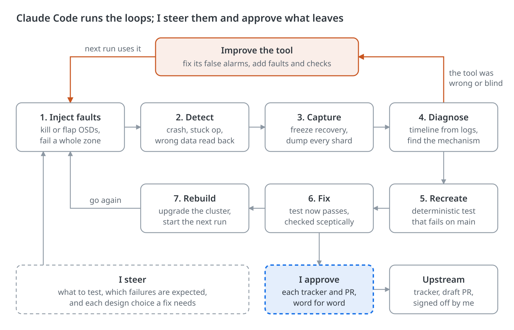
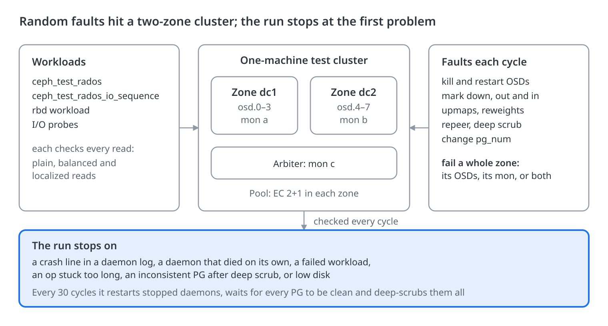
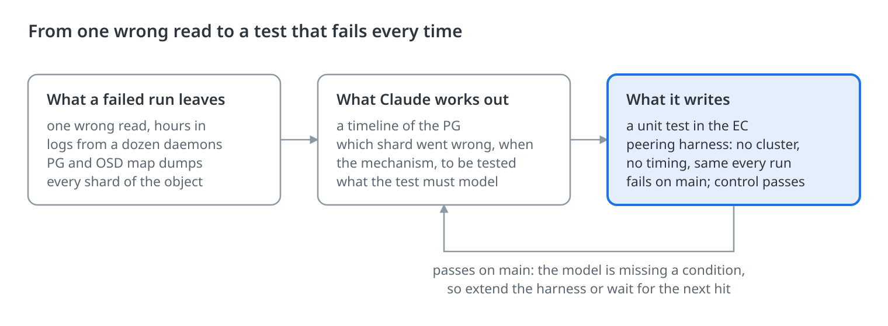
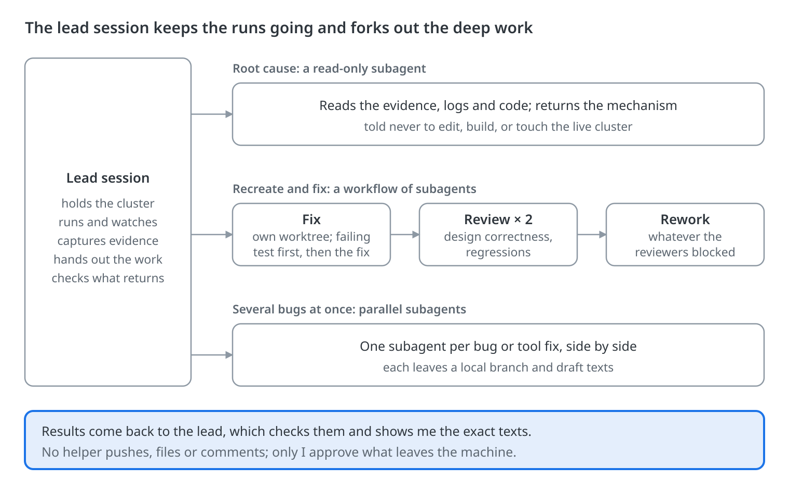
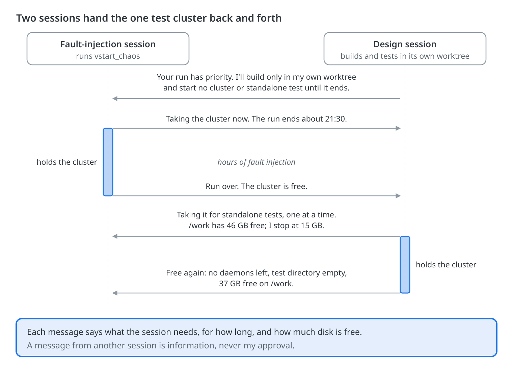

Between 29 September and 12 October 2026 I let Anthropic's [Claude Code](https://claude.com/claude-code) run a whole test-and-fix loop on upstream Ceph while I steered. The loop: inject faults into a test cluster, notice when something breaks, work out why, turn it into a unit test that fails, fix it, rebuild and go again. When the test tool itself was wrong, it fixed that too, so the tool kept getting better as the runs went on.

The first two long sessions (87 hours of Claude Code work, one overnight, one over a weekend) found 50 real defects. 27 were in code already upstream, the oldest dating back to Octopus (2020). A later batch of ten runs found five more on main.

It was not cheap. The first two sessions cost about $840 at API prices, and every fix still needed a person to understand and review it. Even so, I think it cut the human time per bug from about two days to a couple of hours.

The bug count is useful, but what really impressed me was the quality and usability of the fixes.

## Why I wanted this

I write Ceph code for IBM and Red Hat, working on erasure coding. This year that has meant optimized EC, and now erasure-coded pools that span two data centres, so a pool survives the loss of a whole site ([the multi-zone work](https://github.com/ceph/ceph/pull/67879)).

The bugs that matter in this code show up only when something fails at the wrong moment. An OSD dies mid-write. A site drops out while recovery is running. A PG merge waits behind a backfill reservation. Unit tests miss these sequences unless someone already knows what to look for.

Ceph's integration tests (teuthology) do kill OSDs, but each run takes hours. Getting from a failed job to an understood bug with a test can then take a developer days. I wanted the whole cycle on one machine, running while I slept.

## The loop at a glance



Claude Code runs all seven steps, round and round, for as long as the runs go. My part is the two dashed boxes: the direction, and a yes or no on everything that leaves the machine. Steps 4 to 6 often ran in [helper agents](#forking-out-the-deep-work), so the runs did not have to wait for them.

The loop across the top matters as much. When a failure turns out to be the tool's own fault, or a run shows the tool could not see something, Claude fixes the tool rather than Ceph, and the next run uses the better version.

## The fault injector

The tool is `vstart_chaos`, a set of scripts Claude Code wrote with me. It builds a Ceph cluster on one machine with `vstart`, starts client workloads that check every read, and injects random faults in cycles. Faults that take OSDs down stay within each zone's failure budget, so lost or wrong data is a bug, not bad luck.



The tool was never finished. Claude changed it between runs, whenever a run showed it was wrong or missing something:

- **False alarms fixed.** The first campaign found 16 bugs in the tool itself, such as "stuck" reports that were only a loaded host, and clients that leaked for hours after a time limit ended a run.
- **Sharper checks.** The quiesce every 30 cycles now checks every pool and its deep scrubs, and a run stops itself before the disk fills.
- **Better evidence.** Each run chooses its daemon log levels, so a long run keeps the detail a diagnosis needs without filling the disk.
- **Keeping up with the code.** The tool followed the multi-zone work as its commands changed, for example to create pools across both zones.

Every fix to the tool makes the next failure more likely to be a real Ceph bug.

## The hard part: from a one-off failure to a test

Most bug-finding tools get their reproduction for free. A fuzzer hands you the crashing input. A deterministic simulator replays the exact run. A property-testing framework shrinks a failure to a minimal case. A fault-injected cluster gives you none of that: the failure took hours of random faults to set up, and it will not happen the same way again, even with the same random seed.

So the reproduction has to come from understanding. Claude reads the evidence, works out the mechanism and writes it as a unit test in Ceph's peering and EC test harnesses. Those run the real peering and backend code against mock messengers and stores, so the test needs no cluster and has no timing to get wrong.



When the test passes on main, the model is missing something. Claude then extends the harness, for example with hooks that stall or preempt peering events, or waits for another hit to show what is missing. It does not move on to a fix until the test fails.

## One bug, start to finish

This is how one bug went, from the first symptom to an upstream report.

**The symptom.** Four hours into a run on a two-zone EC 2+1 pool, a `ceph_test_rados` client stopped the run. It read an object and got 20 omap keys; its model said 16. Seconds earlier the client had removed four keys, and Ceph had acknowledged the removal.

**The evidence.** Claude froze recovery (`noout`, `norecover`, `nobackfill`), then stopped each OSD in turn and dumped that object's shard with `ceph-objectstore-tool`:

| Shard       | omap keys on disk |
| ----------- | ----------------- |
| 0 (primary) | 20, stale         |
| 2           | 16                |
| 3           | 20, stale         |
| 5           | 16                |

The four extra keys on shards 0 and 3 were exactly the four the client had removed.

**The timeline.** From the OSD logs it rebuilt the two minutes around the write. The fault injector killed three OSDs in the second zone just as the removal was logged. Another OSD came back empty and was backfilled. Then the zone returned, and the read got the old keys.

**The mechanism.** Optimized EC defers omap changes. The update rides in the PG log entry and reaches the object store only when that entry rolls forward on every shard. This one could not roll forward, because its zone had just died. Recovery then copied a shard's on-disk omap, still holding the four keys, and marked the object current. The removal was never applied.

**The first test passed.** Claude's first recreate test (remove keys while a shard is down, then recover) passed on main. Writing it exposed three bugs in the test harness itself, which it fixed. In the test, though, the entry rolled forward before recovery copied anything, so the real bug stayed hidden.

**The second hit.** The next run hit the same family: an omap key set, not a removal, was lost. Its logs showed recovery running while the PG was only peered, below `min_size` and not yet active. That was the missing condition. The new test raises `min_size`, fails one more shard, recovers and checks the omap. It fails on main.

**Filed, with my approval:** [tracker 81630](https://tracker.ceph.com/issues/81630) and the tests-only draft [PR 72582](https://github.com/ceph/ceph/pull/72582). The fix comes next, and the test will prove it.

## Tripwires: making silent corruption crash early

When a checker sees bad data, the cause may be hours and thousands of operations back. So when Claude had a theory about where data could go wrong, it wrote an assertion for that exact point. The OSD aborts the moment it happens. The runs log at level 1 to file and keep level 20 in memory, so the crash also writes out the detailed log of the seconds before.

Three of these ran in the later runs. They are marked DNM (do not merge) and never left my machine:

- abort when an EC write is planned with a stale old object size;
- abort when a read-modify-write read is skipped because the range looks like a clone's hole;
- abort when an EC object context outlives an interval change.

Before any run relied on the first one, Claude showed it firing on the cases it was written for. None fired in the runs that followed. That is a result too: those theories did not explain the failures we saw.

## Forking out the deep work

Diagnosing and fixing a bug takes hours, and the fault injector should not sit idle meanwhile. So the session running the faults worked as a lead. It kept the cluster, the runs and the evidence, and forked much of the diagnosis, recreate and fix work off to helpers. Claude Code can start subagents, each with its own brief and context, and run workflows: scripts that run several subagents in stages.



- **Root cause.** A read-only subagent got the captured evidence and one question, such as why an OSD hit an assert in the PG log code. Its brief said not to edit, build, or touch the live cluster or its processes. It came back with a mechanism.
- **Recreate and fix.** A workflow took one bug at a time. A fixer in its own worktree wrote the failing test, then the fix. Two reviewers checked design correctness and regressions, and a rework stage fixed whatever they blocked on. After the first overnight run, one workflow fixed every confirmed bug: a fixer per area of the code, one commit per bug, two reviewers per area, then a full build, all unit tests and a final completeness check.
- **Several at once.** On one day the lead started five subagents within a few minutes, each with its own set of fixes: monitor defects, fault-injector fixes, a manager crash.

The helpers never push, file or comment. The lead checks what comes back, and I see the exact texts before anything leaves. Helpers cost more, too: a workflow with two reviewers per fix runs several Claude instances for every bug.

## Running unattended

A run needs nobody at the keyboard, but someone has to notice when it stops. This set-up worked:

- **An overnight driver.** A shell script runs up to three runs in turn, each up to 9 hours, all ending by 06:30. It stops at the first run that does not pass and leaves that cluster up to inspect.
- **A check-in every 30 minutes.** Claude starts a background command that returns after 30 minutes, or as soon as a run ends. Its return wakes Claude, which reads the status and either waits again or starts on the failure.
- **Evidence before anything is wiped.** The next run destroys the cluster, so the first job after a failure is capture. That means the client's log, PG and OSD map dumps, each daemon's log for the minutes around the failure, and a dump of every shard of the object. Diagnosis starts after that.
- **A runbook and memory notes.** A long session outlives its context window, and a new session starts knowing nothing. So the rules live in a runbook (how to run, capture and file) and in Claude Code's memory notes, one fact per note. Every correction I made became a note.
- **A shared machine.** Other Claude Code sessions work on the same box, so the session running faults books the one test cluster and watches the disk. [More on that below](#sharing-one-machine-with-other-claude-sessions).

### Sharing one machine with other Claude sessions

The fault injector was never alone on the box. Usually several other Claude Code sessions were working there too: rebasing PRs, building and unit-testing fixes, writing a design. They all share one disk, the CPUs, the network ports that Ceph's standalone tests use, and room for exactly one test cluster.

So each session looks after its own footprint. The rules are memory notes, so a new session starts out knowing them:

- **One test cluster, booked.** It always runs from the same build directory. The session that takes it tells the others what it is running and until when, and tells them again when it is free.
- **A disk floor.** Keep at least 15 GB free on `/work`. A 10-hour two-zone run needs about 50 GB, so the session that wants the cluster checks first. Builds that don't need to be on `/work` go to a separate scratch file system.
- **One standalone suite at a time.** Many of Ceph's standalone tests share monitor ports, a couple kill `rados` processes host-wide, and each can write several GB of logs.
- **Considerate builds.** `ninja -j20` on a machine others use too. Check for a running ninja first, and never relink in a directory that running daemons load libraries from: one relink of `libceph-common` under a running test batch voided the whole batch.
- **Clean up after yourself.** For one weekend I gave a session the job of keeping the disk clear: core dumps, old logs, test binaries nobody needed. Before it removes a worktree, it commits any uncommitted work as WIP and writes down what it removed.

When the rules are not enough, the sessions talk to each other. Claude Code sessions on one machine can list each other and send messages, and a message arrives in the other session's conversation. Three conversations that happened:

- **Who has disk to spare?** With `/work` down to 17 GB free, one session listed every build directory on `/work` and `/work2` and asked the others to free their own. Each replied with what was theirs. One removed three worktrees whose work was pushed or merged, kept one whose build was still running, and freed that too when the build finished. Between them, `/work` went back up to 68 GB free.
- **Whose cluster is this?** A session found a test cluster it hadn't started and asked around. Each session checked its own history (no `vstart.sh`, no daemons started) and said so. The one that had run the earlier clusters explained that the current one belonged to a third session, which I had given priority.
- **Handing over the cluster.** The diagram shows a typical exchange between the fault-injection session and a design session.



A message from another session is information, not my approval. Sessions free only what they created, and anything else waits for me.

## Where I stayed in charge

Claude Code did the work between check-ins. I set the direction and owned the decisions that mattered:

- **What to test:** which pools, EC profiles and faults, and when to change them.
- **What counts as a bug.** Some failures are expected: quorum loss while a zone flaps, objects briefly unfound during a failover, an EC acting set naming one OSD twice for a while. I ruled on each, and each ruling became a memory note.
- **Design.** When a fix needed a design choice, Claude wrote up the options and stopped. One bug, where acknowledged writes became unfound after a zone returned, waited for my decision rather than getting a quick patch.
- **Everything that leaves the machine.** Claude never files a tracker or opens a PR unless I ask. It shows me the exact title and text, and I approve each one. PRs start as drafts. Commits carry an `Assisted-by: Claude Code` trailer, and I add the sign-off myself.

The working rules are short:

1. Confirm a bug empirically before writing a fix.
2. Every production-code bug gets a recreate test that fails before the fix, with a control case that passes.
3. When the bug is on main, write the test on main.
4. File trackers only for defects on main. Defects in the new branch go in notes and fork PRs.
5. Compile build changes the way CI does (`-Werror`, the Windows test target) before showing them to me.

## What came out

55 real defects in all: the 50 from the first two long sessions (27 of them in code already upstream), plus the 5 on main from the later batch of ten runs. That makes 32 in code already on main. Four of the upstream fixes have merged so far. The rest are in review or waiting for review.

| Campaign                                               | What ran                                                            | Time                                   | Real defects                     |
| ------------------------------------------------------ | ------------------------------------------------------------------- | -------------------------------------- | -------------------------------- |
| 29 Sep to 5 Oct: one overnight and one weekend session | 21 fault-injection runs, plus Ceph's standalone and workunit suites | 87 h of Claude Code work (20 h + 67 h) | 50, of which 27 in upstream code |
| 8 to 12 Oct                                            | 10 runs, two-zone EC 2+1, about 8,600 fault cycles                  | 36.7 h of fault injection              | 5, all on main                   |

Where the first 50 were:

| Where                                                                         | Defects |
| ----------------------------------------------------------------------------- | ------- |
| Upstream code, fix PR from me                                                 | 13      |
| Upstream code, already fixed by someone else (we hit it or carried their fix) | 5       |
| Upstream code, no PR yet                                                      | 9       |
| The new multi-zone code, fixed on its branch                                  | 23      |

Not counted above: 16 bugs in the fault-injection tooling itself, all fixed in the scripts, and 10 reports that were not bugs (expected behaviour, or Claude's own mistakes).

## What it cost, in money and people

At API list prices the first campaign cost about $370 for the 20-hour session and $470 for the 67-hour one. That made these expensive runs, and the money was the smaller cost.

The bigger cost was human work. Every fix has to be understood and reviewed by a person before it goes anywhere, and the runs produced a lot of fixes:

- **Fix quality was high.** Over 90% of the fixes were sound. But many, particularly deep in peering, needed quite a bit of tweaking and discussion to get right.
- **The write-ups were often not good enough.** Many commit messages and PR descriptions did not explain the fix clearly. Some took many attempts before a reviewer could understand exactly what the fix was.

The loop made finding and fixing bugs much faster. Claude made understanding them faster too, but that meant a person sitting down with Claude to go through each fix. That is still human time, and the runs created a lot more of it.

Even so, it is a massive win. My rough estimate is that finding and fixing a bug like these takes a developer about two person-days. With the loop, the human part came down to a couple of hours per bug, spent really understanding it. Across the 50 defects of the first campaign, that is roughly 100 person-days of work down to about 13, for $840 of API time.

## What went wrong

Plenty, and the fixes make up most of the runbook.

- **A failure sat unnoticed for six hours.** The 30-minute check was once started detached from the session, so its return woke nobody. A run failed at 00:27 and nobody looked until 06:22. The check now always runs as a tracked background task.
- **The disk filled, more than once.** Four standalone test suites run side by side filled `/work`, and every daemon in the test cluster died for lack of space. On long runs the logs grew fast: the manager's debug log alone wrote about 3 GB an hour, and monitor-client resend messages filled the OSD logs. A log-level option (`-D osd:monc=1/20`) now keeps the resends out, and the tool stops itself below 10 GB free. The rest of the fix is in [the rules for sharing the machine](#sharing-one-machine-with-other-claude-sessions), above.
- **Claude killed its own shell.** It stopped processes by matching their command line, and the pattern also matched its own shell. It now lists processes and kills exact PIDs.
- **Tests fought each other.** A standalone test suite running alongside used `pkill`, which killed a fault-injection run's clients. That became an upstream fix of its own ([PR 72379](https://github.com/ceph/ceph/pull/72379)).
- **One mystery is still open.** In one run, data read back as zeros after a rollback. Chasing it found a real regression ([tracker 81611](https://tracker.ceph.com/issues/81611)), but that run's own zeros were never traced.

Most of these were about process, not about how clever the model is. They needed the habits I would want from a new team member: write it down, check it, and don't trust a pattern match.

## Is this new?

No single step is new. What I could not find published is an agent running the whole loop against a real distributed storage system, improving its own test tool as it goes, and above all reproducing failures by reasoning rather than by replay.

| Work                                                                                                    | What it does                                                                                                                            | How this differs                                                                                                       |
| ------------------------------------------------------------------------------------------------------- | --------------------------------------------------------------------------------------------------------------------------------------- | ---------------------------------------------------------------------------------------------------------------------- |
| Jepsen; Ceph's own teuthology thrashers                                                                 | Fault injection with checkers on real clusters                                                                                          | No AI. Diagnosis and reproduction are the developer's job.                                                             |
| [Antithesis](https://antithesis.com/)                                                                   | Runs the whole system in a deterministic simulator with faults; every bug comes with a perfect reproduction, and agents can fix from it | The simulator makes the failure repeatable. Here the agent does, from logs on an ordinary cluster.                     |
| [DARPA AIxCC](https://www.darpa.mil/news/2025/aixcc-results) (Aug 2025)                                 | AI systems find, prove and patch vulnerabilities: 54 of 63 planted bugs found, 43 patched, 18 real ones found                           | Security bugs in single programs. The fuzzer hands over the crashing input.                                            |
| [Google's BRT agent](https://arxiv.org/abs/2502.01821) (2025)                                           | Writes bug reproduction tests for 28% of 80 reported bugs; with them, automated repair fixes 30% more                                   | Starts from bug reports people wrote, not from bugs it found.                                                          |
| [Property testing with agent swarms](https://recursion.wtf/posts/agents-and-property-tests/) (Oct 2026) | Agents write property tests; each fix PR is a test that fails before the fix plus a minimal fix; twelve merged                          | The closest in spirit, but on libraries and data structures, where the test framework shrinks a failure automatically. |
| [ChaosEater](https://arxiv.org/abs/2501.11107) (2025)                                                   | LLMs run the whole chaos-engineering cycle for Kubernetes systems defined as code                                                       | Improves the system's configuration rather than hunting bugs in the software under test.                               |
| [Agora](https://arxiv.org/abs/2605.29910) (2026)                                                        | LLM agents found 15 safety bugs in Raft, EPaxos, HotStuff and BullShark                                                                 | Finds bugs; the abstract describes no recreate tests or fixes.                                                         |
| [DDBench](https://arxiv.org/abs/2608.14863) (Aug 2026)                                                  | Benchmark of 60 historical bugs from 13 distributed systems; calls distributed-system debugging "under-explored"                        | Repair of known bugs only.                                                                                             |

A search cannot prove that nobody has done this. Plenty of teams may work this way without writing it up, which is one reason I am writing this one.

## Try it

The fault injector is `src/script/vstart_chaos`, in draft [PR 72412](https://github.com/ceph/ceph/pull/72412), with a guide in `doc/dev/vstart_chaos.rst`. From the top of a built source tree:

```sh
CEPH_BUILD=$PWD/build src/script/vstart_chaos/run_chaos.sh -p erasure -k 2 -m 1 -t 7200
```

That runs up to two hours of faults on an EC 2+1 pool in one zone. On main, a two-zone run needs `-p replicated`, because main does not have `--num_zones` pools yet.

You don't need an AI to run it. If you do hand it to one, give it three things first: a way to wake it when a run ends, a recipe for capturing evidence before the next run wipes the cluster, and the rule that nothing counts as a bug until a test fails. Then keep time for the review: every fix it finds still needs a person to understand it.

## Sources

- [Antithesis](https://antithesis.com/)
- [DARPA: AI Cyber Challenge results](https://www.darpa.mil/news/2025/aixcc-results) (8 Aug 2025)
- [Agentic Bug Reproduction for Effective Automated Program Repair at Google](https://arxiv.org/abs/2502.01821)
- [Property Testing with Agent Swarms](https://recursion.wtf/posts/agents-and-property-tests/), Inanna Malick
- [ChaosEater: Fully Automating Chaos Engineering with Large Language Models](https://arxiv.org/abs/2501.11107)
- [Agora: Toward Autonomous Bug Detection in Production-Level Consensus Protocols with LLM Agents](https://arxiv.org/abs/2605.29910)
- [Evaluating Agentic Code Repair Capabilities in Distributed Systems (DDBench)](https://arxiv.org/abs/2608.14863)
- Ceph: [PR 72412](https://github.com/ceph/ceph/pull/72412) (fault injector), [tracker 81630](https://tracker.ceph.com/issues/81630) and [PR 72582](https://github.com/ceph/ceph/pull/72582) (the worked example), [multi-zone PR 67879](https://github.com/ceph/ceph/pull/67879)
