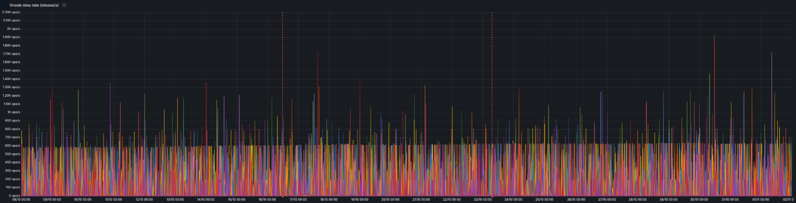
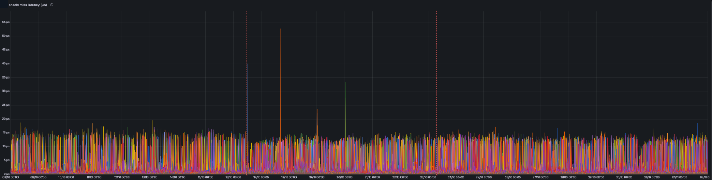
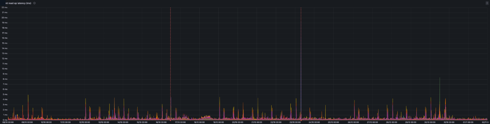

You're looking at more than 10,000 euro worth of RAM, and that's counting refurbished prices, not
even new. More than 2 TiB in 67 DIMMs, taken out of our Ceph OSD nodes. Thanks to the Ceph
community and attending Ceph Days events, I was able to move it to nodes that make much better use of it. Without buying a single
DIMM.

But let me start at the beginning.

When you start with Ceph, you mostly see the software. The docs, the `ceph -s` output, and lots of
HEALTH_WARN messages where you don't even know where to start looking. At least, that's how it went
for me. After a training course, I spent a couple of months exploring Ceph 100% on my own. Back then,
I simply wasn't aware of the Ceph community, or of the people behind Ceph. And that's a pity,
because for me the community turned out to be one of the most useful parts of running Ceph.

This post is for people who are new to Ceph and maybe don't know what's going on in the community,
or who think events are only for developers and people with 50 PB clusters.

## Is Ceph some obscure "file" system?

When we started looking at Ceph, one of the concerns of our management was exactly that: is this
some obscure "file" system? A fair question, because we had been there before. The network file system we use for general
purpose, which CephFS is going to replace, is, as far as I know, maintained by only a handful of
developers, without a large install base or community around it. You can't find that much about it
online. No subreddit, no Slack. When something goes wrong, we're mostly on our own, and we wanted to
avoid yet another system where that was the case.

With Ceph, it's the other way around. Ceph has a large [install base](https://telemetry-public.ceph.com/?orgId=1&from=now-6M&to=now&timezone=browser&var-display=Major&var-major=$__all&var-minor=$__all&var-daemons=$__all),
and the numbers on that telemetry dashboard are probably only a small part of what's running in
the wild. Around all those clusters, there's a vibrant community: mailing lists, Slack, a subreddit,
monthly meetups and events all over the world, full of operators and developers who share what
works and what doesn't.

## Thrown to the sharks

At the first Ceph Days event I attended, I also [gave a talk](https://www.youtube.com/watch?v=oVrBbH6LjpI&list=PLDhUTUI2hFE8&index=3). That was sort of scary. What was I, as
a relative newbie, going to bring to the table in front of about 100 people, many of them god-level
Ceph developers?

But the feedback I got was really cool. After my talk, someone came up to me and asked: "Why do you
have a cluster network in the first place?" That one caught me off guard. I had read the docs, set up
a separate cluster network and never questioned it. It just seemed like the obvious thing to do. And
here was someone who knows a lot more about Ceph than I do, asking me why.

That's the kind of question you don't get from reading docs on your own.

## Every event, I came back with a to-do list

Since then, every time I went to a Ceph event, I spent the trip home writing out my notes and
turning them into to-do and action points, so I wouldn't forget what I jotted down during the talks.

Ceph Days events have something for everyone, from people just getting started to people running
very large clusters. And the talks are relevant to what's happening in the storage landscape right
now. With RAM and disk prices going through the roof, a
talk called "[Every Byte Counts!](https://ceph.io/en/community/events/2026/ceph-days-zurich/)" couldn't have come at a better time.

Two examples from the last event I went to, Ceph Days Zurich 2026.

### The RAM: from the OSD nodes to the MDS nodes

When I built our main cluster (right before RAM prices skyrocketed), we were only running RBD.
CephFS was on my radar all the time, because we weren't happy with our current
network file system, and CephFS looked much better on paper. But my first priority was to make the
migration from VMware and a SAN to Proxmox and Ceph RBD a success. So I figured I'd rather have too much RAM in the OSD nodes than too little.

Only later, when we started to use CephFS, did we notice that the MDS daemons needed way more RAM than we
expected. We had cases where, after an MDS fail-over, too many MDS processes landed on the same
node, one of them holding around 100M inodes, and the OS OOM-killed the MDS processes. Not fun. I
wanted more MDS nodes, and slightly more RAM in each of them.

(Side note: part of the reason we underestimated it is that we didn't really know how many files
we had. Our simulation data used to live on TrueNAS, shared over NFS, and getting a recursive file
count there is cumbersome when you have millions and millions of files and directories. On CephFS, the
MDS keeps that count for you, so instead of walking the entire directory tree, it's a simple and
cheap query: `getfattr -n ceph.dir.rentries /mnt/cephfs` gives the number of files and directories
under that directory right away.)

The RAM was already in our Ceph cluster, just not in the right place. But taking it out of the OSD
nodes wasn't a free lunch either. I wanted to settle on 128 GiB per OSD node, which should still be
plenty for only 12 OSDs. Should. Meanwhile, on many nodes, the OSD processes together were using
more than 144 GiB RES. So I wasn't sure reducing the RAM to under 144 GiB was a good idea.

This had been bothering me for quite some time. I knew what I wanted to do, but Ceph underpins our
entire IT infrastructure, so I wasn't going to make that kind of change without knowing what the
impact would be.

Then, at Ceph Days Zurich, I attended
[that talk](https://ceph.io/assets/pdfs/events/2026/cd-zurich/6_Every_Byte_Counts!_Ceph_Capacity_Optimization_in_Expensive_Times.pdf).
It showed how you can measure whether lowering the RAM has an effect, starting from the onode cache
hit ratio ([slide 26](https://ceph.io/assets/pdfs/events/2026/cd-zurich/6_Every_Byte_Counts!_Ceph_Capacity_Optimization_in_Expensive_Times.pdf#page=28)). That was exactly the
piece I was missing.

So I built a Grafana dashboard with those statistics: onode cache hit ratio, onode miss rate, onode
miss latency and client read op latency. I first ran one OSD node with less RAM for a week, with a
Grafana annotation at the moment of the change, and compared it to the week before. No visible
difference. So I reduced all the remaining OSD nodes to 128 GiB as well, and marked that moment too.

For context, this is what the cluster looks like:

| | |
|---|---|
| OSDs | 144 SAS SSD OSDs, 12 per OSD node, and 12 NVMe OSDs |
| PGs per OSD | about 142 on the SAS SSDs, 250 on the NVMe drives |
| OSD memory | `osd_memory_target` at its default of 4 GiB, with `osd_memory_target_autotune` on |
| Workload | a mix of VMs (Proxmox) and CephFS |
| MDS nodes | 4 before, 10 after |
| RAM in the MDS nodes | 1.5 TiB before, 3.84 TiB after |

These are the four panels, from 8 October to 2 November, one line per OSD. The first dashed line
(16 October) marks the moment I took one OSD node from a generous 512 GiB down to 128 GiB. The
second (23 October) is after a week of measurements, when the remaining 11 SAS OSD nodes went to
128 GiB as well (a couple of them also had 512 GiB, most had less). So each graph is divided into three parts: before the change, one OSD node with less
RAM, and all OSD nodes with less RAM.


*Onode cache hit ratio per OSD. The dashed lines mark the first OSD node going from 512 GiB to
128 GiB (16 October) and the remaining 11 SAS OSD nodes (23 October).*



*Onode miss rate per OSD, in misses per second.*



*Average onode miss latency per OSD, in microseconds.*



*Client read op latency per OSD, in milliseconds. In the end, this is the metric that really matters: it's the performance the Ceph clients get.*

Again, no visible difference. And that's how more than 2 TiB of RAM ended up on my desk.

That's no guarantee for your cluster, though. Depending on the hardware and the workload, going too
low on RAM can make the OSDs thrash their caches, and then you do see it, in latency for every client.
That's why I measured first, on one node, for a week, before touching the rest.

Those DIMMs were added to existing and new MDS nodes, where they do a lot more for us than they did in the OSD nodes. In
times of extremely expensive RAM, you don't just go and buy more unless you
`--yes-i-really-really-mean-it`. Thanks to this talk, we didn't have to, and we were still able to
go from 1.5 TiB to 3.84 TiB of RAM for the MDS daemons, spread over 10 nodes instead of 4.

### 40% disk space back on our archive servers

The same talk had a second tip I didn't expect: using LVM with VDO (Virtual Data Optimizer) for
deduplication and compression. Our archive file servers, where archived data rests, hold the kind of data
that compresses and deduplicates well, so I gave it a try.

We're saving 40% of the disk space on those servers. That's not a lab number, that's production.

And the cost? I put some write load on one of those servers with fio for 10 minutes, with data that
partly compresses and deduplicates: about 50 MiB/s on average. All VDO threads together used less
than half a CPU core (39% on average, 46% at most). The limit there was the path to the file server,
not VDO.

In both cases, what made the difference was hearing someone who has done it explain why it works,
where the limits are, and how to check it on your own cluster.

## The other half of our MDS problem

Remember those MDS fail-overs that ended with OOM-killed MDS daemons? That turned out to be only
half of the story.

We finished our migration to CephFS in April 2026, and MDS fail-overs never really worked well
from the start: clients lost their mounts. Part of that was RAM, and moving those DIMMs to the MDS nodes took
care of it. But even with plenty of RAM, fail-overs still went wrong, and clients still lost their
mounts. I always suspected the kernel client, since our clients run RHEL 8 with its Linux 4.18
kernel. I looked at it with several people, we tried a few things, and nothing fixed it.

So at some point I decided to throw Claude at it. I gave it full access to a dedicated Proxmox node
and asked it to set up a Ceph cluster as close as possible to our real one, fill a CephFS file
system with an enormous amount of files and then fail over the MDS. Nothing doing. The fail-over
went fine, every time.

Then I did the same, but took a CephFS snapshot first. And there it was: the problem, reproduced in the
lab. The clients failed in exactly the same way as our production clients did. This is what the
kernel log of one of our production clients looked like (IP addresses changed):

```
[Mon Aug 17 06:02:08 2026] libceph: mds0 (1)192.0.2.17:6807 io error
[Mon Aug 17 06:02:09 2026] libceph: mds0 (1)192.0.2.17:6807 io error
   ... (repeats once per second for minutes) ...
[Mon Aug 17 06:17:43 2026] ceph: ceph_do_invalidate_pages: inode 10021d945a3.fffffffffffffffe is shut down
[Mon Aug 17 06:17:43 2026] ceph: ceph_do_invalidate_pages: inode 10021da6401.fffffffffffffffe is shut down
[Mon Aug 17 06:17:43 2026] ceph_do_invalidate_pages: 395 callbacks suppressed
[Mon Aug 17 06:17:43 2026] libceph: mds0 (1)192.0.2.17:6807 io error
```

In the lab, the clients logged the same `libceph: mds0 ... io error` lines, several times a second.

At a very high level, this is what happens. When you create a CephFS snapshot on a subdirectory, the
MDS sends every client that holds caps under that directory a message listing all the inodes under
that directory that have caps, from all clients together. So even a client with only a handful of
caps there gets the full list. With a few million of those inodes, that message gets larger than
16 MiB, and the Linux kernel client refuses any message that big. It drops the connection and
reconnects, the MDS sends the same message again, and so on. Meanwhile, those clients can't do
anything with the file system.

We weren't even aware of that loop. All our engineers noticed was their simulations crashing, because
a path on CephFS had become unresponsive.

I posted my findings in the cephfs channel on the Ceph Slack. Someone there confirmed it, and
pointed me to an open bug report: [tracker.ceph.com/issues/76530](https://tracker.ceph.com/issues/76530).
That ticket describes another path to hit the issue, but underneath it's the same bug. The current
Tentacle release, 20.2.5, doesn't have the fix yet, but hopefully the next one will, and the next Umbrella point release too.

So Claude helped me find the root cause, and one short conversation on Slack did the rest. After
months of going around in circles, I now have confirmation that this is indeed what we're hitting,
what the problem is and how to avoid it: either wait for a point release with the fix, or stop taking those
snapshots and remove the ones that are left. Ours were redundant anyway.

## The hallway track

The talks are one part. The coffee breaks, the lunch and the evening are the other.

Talking with fellow operators always gives me a lot of inspiration. You find out that other people
have the same problems you have, and some of them already solved them. Someone mentions a tool, a
config option, a monitoring trick or a way they handle upgrades, and you write it down. Or you
explain your own setup and someone asks a question you never asked yourself, like that cluster
network question.

And nobody expects you to be an expert. Most people are happy to talk about their clusters, the good
parts and the bad parts. Operators love war stories :)

## Where to find the community

If you're new, here's where things happen. Pick one and start there.

* **[Ceph events](https://ceph.io/en/community/events/)**: Ceph Days are one-day events in different
  cities around the world, small enough to actually talk to people, and a good first event.
  Cephalocon is the yearly Ceph conference, with users, operators and developers in one place. The
  events page also lists meetups and Ceph talks at other conferences.
* **[ceph-users mailing list](https://lists.ceph.io/postorius/lists/ceph-users.ceph.io/)**: questions
  from real operators, answered by other operators and developers. Even only reading along teaches
  you a lot.
* **[Ceph Slack](https://join.slack.com/t/ceph-storage/shared_invite/zt-453jwr8e9-wu~QvC0jcH4oZBug3oMgdg)**: for quicker questions and chat.
* **[r/ceph](https://www.reddit.com/r/ceph/)**: the Ceph subreddit, for questions, war stories and
  news.
* **[Ceph YouTube channel](https://www.youtube.com/@Cephstorage)**: recordings of talks from past
  events. If you can't travel, start here.

## Just go

If you're running Ceph, or thinking about it, go to a Ceph event. Bring your questions, bring your
weird cluster stories, and talk to people. And if you have a story to tell, consider giving a talk
yourself. You'll get more out of the questions
and conversations afterwards than you put into the slides.

You'll probably come back with at least one idea that pays for the trip. In my case, more than 2 TiB
worth of it, a lot of disk space, and in the end even the answer to a problem that had been bugging
me since April.

## Thanks to the people behind the scenes

Finally, I want to thank the people who organize these events. A lot of work happens behind the
scenes to make them happen, from finding a venue and sponsors to selecting the talks and making sure
everything runs smoothly on the day. As an attendee you hardly notice any of it, which says a lot
about how well it's done. And thanks to every speaker who takes the time to share what they learned.
