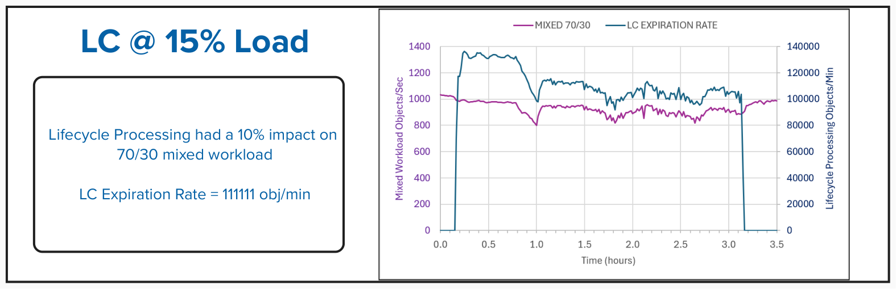
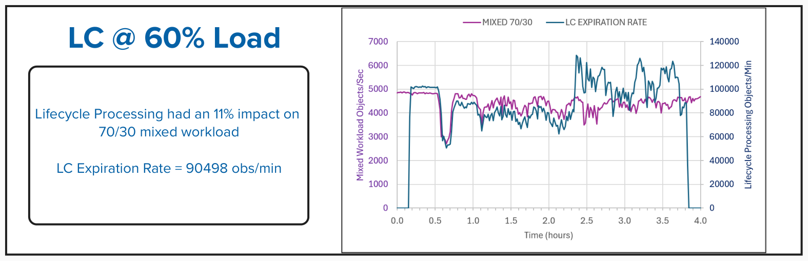

## Intro
Object storage deployments keep growing and bucket sizes are now routinely
exceeding what were once considered generous limits. While AI, modern
analytics, and data lake workloads are pushing bucket sizes to an all-time
high, the effects on metadata performance and object list latency are becoming
concerns.

This blog explores the performance impact of configuration options, garbage 
collection, and lifecycle policy management on the common `PUT`, `LIST`, `GET`,
and `DELETE` operations. The data talked about here was taken from synthetic 
workloads on Ceph Object Gateway (RGW) to better understand the effect large 
buckets have on performance, and to learn how complex metadata is handled in
Ceph so we can create practical guidelines on how to handle buckets of this
size. The I/O driver used to generate workloads was `elbencho` unless 
otherwise specified.

## Test Environment

4 servers were used for the Ceph storage cluster:

| Component | Specification |
| --------- | ------------- |
| Processor | 2 x 32-core server CPUs (64 cores total, or 128 HT cores, in each server) |
| Memory | 512 GB RAM |
| Ceph upstream release | 20.2.1 (Tentacle) |
| Operating system | Enterprise Linux, release 10.2 |
| OS disks | 2 x 480 GB RAID-1 SSD |
| NVMe disks | 16 x 15.36 TB read-intensive enterprise PCIe Gen 4 TLC SSDs |
| Network interfaces | Data: dual-port 100 GbE adapter<br>Management: 2x 1 GbE |

4 physical clients were used to drive the workload:

| Component | Specification |
| --------- | ------------- |
| Processor | Server CPU @ 2.40 GHz |
| Memory | 256 GB RAM |
| Operating system | Enterprise Linux, release 10.1 |
| Network | 2x 100 GbE links (using one dual-port 100 GbE NIC) |

*Additional environment details provided at the end of the article.*

## Creating the Objects

**Test Description:** We created a single bucket and pre-sharded it to
`num-shards=20011`. This value was used to stay below the default 
`rgw_max_objs_per_shard` value of 100000 in order to avoid resharding during
the exercise when creating 2 billion objects.  The value of 
`rgw_max_dynamic_shards` was also raised to 20011, which is above the default 
limit of 1999. Then we populated the bucket to 2 billion 64KiB objects using a
realistic lakehouse prefix layout (e.g.
`warehouse/db/table/metadata/... and warehouse/db/table/data/partition/...`).


## Listing the Objects

The term "Latency" used here is the amount of time it takes for the issued
operation to complete.

**Test Description:** We ran a single CLI command with `aws s3api`, `boto3`,
`elbencho`, or `s5cmd` to return the first page of 1000 S3 objects.

Based on the baseline latency results for the four clients used for listing
objects combined with the overall demands of workload patterns for the testing
in this document, we decided to go with `elbencho` as our primary testing driver.

**Test Description:** We ran a single `elbencho` command to return the first page
of X objects, where the value of X is between 1000 and 100000 objects.


## Resharding Disruption Window at 2 Billion Objects

**Test Description:** Using `elbencho`, we started up a steady-state mixed workload
of 70% `GET` and 30% `PUT` at the 64KiB object size that ran at 35% of the
system's maximum throughput. We let the workload run for ~20 minutes, then we
issued the `radosgw-admin` command to manually reshard the bucket to
`num_shards=25013` to observe the impact dynamic resharding has on host I/O. 
25013 shards was selected to target an objects per shard ratio of 80%.

We manually resharded the bucket from 20011 to 25013, which with 2 billion
objects required an elapsed 5 hours and 51 minutes. Beginning with the Tentacle
release, client writes are accepted during resharding: new objects accumulate
as "delta keys". When resharding completes, bucket writes are blocked while
these delta keys are integrated. This block and the concomitant drop in
performance is expected behavior. Earlier Ceph releases blocked for the entire
reshard process; this recent optimization significantly improves the client
experience during dynamic or manual resharding. For workloads where the number
of RGW objects per bucket is reasonably constant, pre-sharding the bucket may
still be beneficial. For workloads where the number of objects per bucket
varies considerably over time, dynamic resharding can enable faster `LIST`
operations when the object count is lower.

For the remainder of testing below, the bucket was recreated and populated with
the `num_shards=20011` setting.


## Delete Performance at 2 Billion Objects

### Multi-Delete versus Structured-Delete

During our delete testing, we were presented with two methods of handling
deletes using `elbencho`:

• Multi-Delete utilizes the `--s3multidel` parameter and batch deletes
  range from 1-1000. Prior knowledge of the directory structure is not
  required. The application issues a listing of the targeted prefix contents
  and then processes the deletions based on the listing. It is important to
  note that `--s3multidel` is a single-threaded operation with `elbencho`.

• Structured-Delete does not use the `--s3multidel` parameter and thus
  requires prior knowledge of the directory structure within the given prefix
  to correctly delete the objects.

**Test Description:** We deleted 10 partitions of 39600 objects each with a
single RGW.

| Metric | Multi-Delete | Structured-Delete |
| ------ | -----------: | ----------------: |
| Total partitions deleted | 10 | 10 |
| Total objects deleted | 396000 | 396000 |
| Batch deletion count | 1000 | 396000 |
| Number of RGW endpoints | 1 | 1 |
| Number of `elbencho` threads | 1 | 132 |
| Average objects/sec | 2228 | 24321 |
| Average latency (ms) | 444.50 | 5.25 |

Multi-Delete is limited by the fact that it is a single-threaded operation,
and it also produces high client latency since the application needs to list
the objects before it can delete them. Listing large buckets is always a slow
and paginated operation. Some clients or libraries issue a `LIST` before every
command, which is to be avoided.  For the remainder of our testing, we chose
to invoke Structured-Delete.

**Test Description:** Using `elbencho`, we started up a steady-state mixed workload
of 70% `GET` and 30% `PUT` at the 64KiB object size. We let the workload run for 10
minutes, then we issued the `elbencho` command to Structured-Delete 19.8 million objects.


Structured-delete is faster to delete many objects because it is not only
multi-threaded, but it also does not require the application to list objects before
deleting them. Adding host I/O will not elongate the duration of the deletion
window by much. However, impact on host I/O is high since system resources are
more committed to the delete operation.

## Garbage Collection at 2 Billion Objects

To properly invoke garbage collection after deletion, we created a mixed
object-size profile of 2 billion small objects (size 64KiB in `metadata/` and
`data/`) and 10 million large objects (size 16MiB in `data/`).

**Test Description:** Using the structured-delete method with `elbencho`, we removed
2 million 16MiB objects.

After the deletion operation processed, 2 hours later the objects were moved to the
GC queue until it was filled with the 2 million objects; the 2-hour wait period was due
to the default setting of `rgw_gc_obj_min_wait=7200`. 1 hour later, the system 
automatically began processing the GC queue; the 1-hour wait period was due to the
default setting of `rgw_gc_processor_period=3600`. The average drain rate of the GC 
queue was 2161 objects/sec, which took 15 minutes and 25 seconds to be fully emptied.


### GC Drain Rate Under Load

**Test Description:** Using `elbencho`, we started up a steady-state mixed workload
of 70% `GET` and 30% `PUT` at the 64KiB object size. We let the workload run for 10
minutes, then we issued the `elbencho` command to structured-delete 2 million 16MiB
objects. We let the GC queue fill fully, then we processed the queue manually after
10 minutes.

For this test, the following variables were adjusted to focus on drain rate
performance:
```
ceph config set client.rgw rgw_gc_obj_min_wait 1800
ceph config set client.rgw rgw_enable_gc_threads false
```


From the garbage collection tests we saw that the background load and GC
processing heavily impacted each other. Once the GC process completed, the
steady-state host I/O returned to the original performance from before the test
began.

### Garbage Collection Tuning

Per Ceph online documentation [Ceph RGW config
reference](https://docs.ceph.com/en/latest/radosgw/config-ref/), garbage
collection can be tuned to be less aggressive or more aggressive.

Default GC Settings:
```
rgw_gc_max_concurrent_io=10
rgw_gc_max_trim_chunk=16
```
Settings used to make GC less aggressive ("Decreased" Profile):
```
ceph config set client.rgw rgw_gc_max_concurrent_io 5
ceph config set client.rgw rgw_gc_max_trim_chunk 8
```
Settings used to make GC more aggressive ("Increased" Profile):
```
ceph config set client.rgw rgw_gc_max_concurrent_io 20
ceph config set client.rgw rgw_gc_max_trim_chunk 64
```

| Host I/O Load as a % of Max for This Cluster | 0% | 15% | 15% | 35% | 35% | 60% | 60% |
| -------------------------------------------- | -: | --: | --: | --: | --: | --: | --: |
| **Garbage Collection Tuning** | **Default** | **Default** | **Increased** | **Default** | **Increased** | **Default** | **Increased** |
| Mixed workload throughput during steady-state (obj/s) | - | 862 | 875 | 2187 | 2215 | 3604 | 3645 |
| `DELETE` elapsed time (sec) | 269 | 384 | 286 | 362 | 375 | 474 | 452 |
| `DELETE` rate (objects/sec) | 7460 | 5225 | 7005 | 5552 | 5338 | 4238 | 4455 |
| Mixed workload throughput during deletion window (obj/s) | - | 645 | 649 | 1660 | 1664 | 2730 | 2769 |
| Elapsed time to add objects to queue (sec) | 567 | 625 | 557 | 662 | 662 | 761 | 666 |
| GC drain elapsed time (sec) | 925 | 4521 | 4103 | 5184 | 4948 | 5441 | 5575 |
| GC drain rate (objects/sec) | 2161 | 442 | 487 | 386 | 404 | 368 | 359 |
| Mixed workload throughput during GC processing (obj/s) | - | 580 | 564 | 1392 | 1426 | 2442 | 2415 |

The experiments with tuning demonstrated that system resources are limited at
higher background loads. Thus the GC tuning parameters of
`rgw_gc_max_concurrent_io=20` and `rgw_gc_max_trim_chunk=64` are good
suggestions when heavy delete workloads are expected and there is low host I/O
activity. Otherwise, the default values are acceptable.

### Additional Recommendations for Deploying RGW Instances Dedicated to GC Processing
**For Production-Facing RGWs:** Disable GC processing entirely to dedicate all thread
and CPU resources to client S3/Swift API traffic.
```
[client.radosgw.frontend_instance]
rgw_enable_gc_threads = false
```

**For Dedicated GC RGWs:** Deploy separate RGW instances (which do not receive user
traffic via your load balancer) and ensure their GC loops are active.
```
[client.radosgw.gc_dedicated_instance]
rgw_enable_gc_threads = true
```

## Lifecycle Processing at 2 Billion Objects

**Test Description:** Using `boto3`, we applied the LC expiration policy to the
bucket. Example:
```
  "Rules": [
    {
      "ID": "expire-metadata-prefix",
      "Status": "Enabled",
      "Filter": { "Prefix": "warehouse/db/table/metadata/" },
      "Expiration": { "Date": "2024-01-01T00:00:00Z" }
    }
  ]
```
With no client workload running, we processed the 20 million objects manually. We then
tracked the total objects and processing rate over time.


### Lifecycle Processing Under Load with Default Settings

**Test Description:** Using `elbencho`, we started up a steady-state mixed workload
of 70% `GET` and 30% `PUT` at the 64KiB object size. We let the
workload run for 10 minutes, then we issued the `boto3` command to expire 20 million
objects manually.




### Tuning for Lifecycle Processing

Per Ceph online documentation [Ceph RGW config
reference](https://docs.ceph.com/en/latest/radosgw/config-ref/), lifecycle
processing can be tuned to be more aggressive.

The following variables were increased to observe the impact on lifecycle
processing performance:
```
ceph config set client.rgw rgw_lc_max_worker X
ceph config set client.rgw rgw_lc_max_wp_worker X
```


The most aggressive lifecycle processing rate with the shortest total runtime
was observed when the following values were set:
```
rgw_lc_max_worker=12
rgw_lc_max_wp_worker=12
```
We used these settings for the "Increased" Tuning profile in the table below.

| Host I/O Load as a % of Max for This Cluster | 0% | 15% | 15% | 35% | 35% | 60% | 60% |
| -------------------------------------------- | -: | --: | --: | --: | --: | --: | --: |
| **Lifecycle Processing Tuning** | **Default** | **Default** | **Increased** | **Default** | **Increased** | **Default** | **Increased** |
| Mixed workload throughput (during steady-state) | - | 1024 | 982 | 2621 | 2495 | 4855 | 4861 |
| Mixed workload throughput (during lifecycle processing) | - | 919 | 878 | 2280 | 2391 | 4302 | 4440 |
| LC impact to host I/O | - | 10% | 11% | 13% | 4% | 11% | 9% |
| LC elapsed time (min) | 329 | 180 | 192 | 188 | 220 | 221 | 250 |
| LC expiration rate (objects/min) | 60790 | 111111 | 104167 | 106383 | 90909 | 90498 | 80000 |

The lifecycle processing results showed that even when storing billions of
objects, their effects on client workloads was minimal when dealing with
object expiration. When comparing all load levels, lifecycle processing
reduced mixed workload throughput by around 10-13%. LC expiration rate speeds
up when there is background host I/O. However, the heavier the host I/O, the
longer one can expect lifecycle processing to complete. The LC tuning
parameters of `rgw_lc_max_worker` and `rgw_lc_max_wp_worker` can be modified
depending on the user's goals to either limit impact to host I/O or speed up
the lifecycle processing duration during idle periods. Otherwise, the default
values are acceptable.

### Additional Recommendations for Deploying RGW Instances Dedicated to LC Processing
**For Production-Facing RGWs:** Disable LC processing entirely to dedicate all
thread and CPU resources to client S3/Swift API traffic.
```
[client.radosgw.frontend_instance]
rgw_enable_lc_threads = false
```

**For Dedicated LC RGWs:** Deploy separate RGW instances (which do not receive
user traffic via your load balancer) and ensure their LC threads are active.
You can also widen the LC work window and raise the worker counts on these
instances.
```
[client.radosgw.lc_dedicated_instance]
rgw_enable_lc_threads = true
rgw_lifecycle_work_time = 00:00-23:59
rgw_lc_max_worker = 12
rgw_lc_max_wp_worker = 12
```
At least one RGW in each zone must have `rgw_enable_lc_threads` set to
`true`. If the parameter is disabled on every RGW, no lifecycle processing
happens.

**LC Schedule:** By default, LC processing starts once a day and runs only
during a daily work window, set by `rgw_lifecycle_work_time` (default
`00:00-06:00`). When it finishes, it waits for the next window. For heavy
workloads, expect LC processing of a large number of expirations or
transitions to span multiple days.

## Ceph Cluster Configuration

| Configuration | Value |
| ------------- | ----- |
| Upstream Ceph release | 20.2.1 (Tentacle) |
| `osd_memory_target_autotune` | False |
| `osd_memory_target` | 12884901888 |
| `osd_pool_default_flag_ec_optimizations` | True |
| `osd_pool_erasure_code_stripe_unit` | 16384 |
| `osd noscrub` | True |
| `osd nodeep_scrub` | True |
| `rgw_max_dynamic_shards` | 20011 |
| `rgw_max_objs_per_shard` | 100000 |
| `default.rgw.buckets.data` | pg_num 4096, pgp_num 4096 |
| `default.rgw.buckets.index` | pg_num 512, pgp_num 512 |

### Storage & Client Node Tunables

| Configuration | Value |
| ------------- | ----- |
| Tuned profile | `network-latency` |
| CPU governor profile | `performance` |
| C-State profile | `C6 Disabled` |

### Hardware

| Role | Qty | CPU | RAM (GB) | NVMe OSDs | Network |
| ---- | --: | --- | -------: | --------- | ------- |
| Ceph | 4 | 2 x 32-core server CPUs (64 cores total, or 128 HT cores, in each server) | 512 | 16 x 15.36 TB read-intensive enterprise PCIe Gen 4 TLC SSDs | 2x 100GbE (LACP 802.3ad) bonded = 200 Gbps aggregate |
| Client machines | 4 | Server CPU @ 2.40 GHz | 256 | - | 2x 100GbE links (using one dual-ported NIC) |  

### Software

| Tool | Version |
| ---- | ------- |
| [`elbencho`](https://github.com/breuner/elbencho) | 3.0-37 |
| [`aws s3api`](https://docs.aws.amazon.com/cli/latest/reference/s3api/) | 1.45.5 |
| [`boto3`](https://github.com/boto/boto3) | 1.43.5 |
| [`s5cmd`](https://github.com/peak/s5cmd) | v2.3.0-991c9fb |

## Conclusion

This study shows that Ceph can maintain predictable performance for a large
bucket with 2 billion objects. No fundamental issues were found with listing,
resharding, deletion, garbage collection, and lifecycle expiration that
prevented continued operation even at this large bucket size. Through the
tests, it was observed that bucket size was not the limiting factor affecting
performance but in fact it was limited to resources of the cluster. There was
reduced throughput of object deletion and garbage collection at higher levels
of background load in the environment. Lifecycle tuning showed that LC
expiration rate can be increased when there is low host activity. Overall, the
data gathered from these tests show that companies who build large Lakehouse,
analytics, AI, and archival data can confidently scale buckets into the
billions of objects.

<hr style="width: 100%; height: 2px; background-color: gray; border: none;">

Author - Andy Lin (awlin@ibm.com), Editor - Alex Surma (alexander.surma@ibm.com)
