## Intro
Object storage deployments keep growing and bucket sizes are now routinely exceeding what were once considered generous limits. While AI, modern analytics, and data lake workloads are pushing bucket sizes to an all-time high, the effects on metadata performance and object list latency are becoming concerns.

This blog explores the performance impact of create, list, delete, garbage collection, and lifecycle policy management that are common across all organizations. The data talked about here was taken from simulated workloads on Ceph Object Gateway (RGW) to better understand the effect large buckets have on performance and to learn how complex metadata is handled in Ceph so we can create practical guidelines on how to handle buckets of this size. The primary I/O driver used to generate workloads in this environment was elbencho unless otherwise specified.

## Creating the Objects

**Test Description:** Create a single bucket and pre-shard it to `num-shards=20011`. This value is used to stay within the target range of `rgw_max_objs_per_shard` of 100,000 for 2 billion objects. Populate the bucket to 2 billion 64K objects using a realistic lakehouse key layout (e.g. `warehouse/db/table/metadata/... and warehouse/db/table/data/partition/...`).
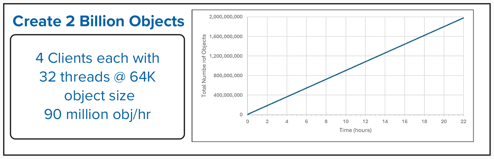

## Listing the Objects

The term "Latency" used here is the amount of time it takes for the issued command to complete. In the case of boto3, the latency result was measured from inside python, not outside at invocation.

**Test Description:** Run a single CLI command with aws s3api, boto3, elbencho, or s5cmd to return the first page of 1,000 keys (objects).
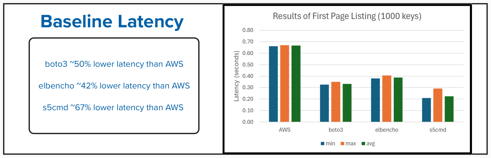
Based on the baseline latency results for the four methods used for Listing Objects (aws s3api, boto3, elbencho, s5cmd) combined with the overall demands of workload patterns for the testing in this document, we decided to go with elbencho as our primary testing driver.

**Test Description:** Run a single elbencho command to return the first page of X keys, where the value of X is between 1,000 and 100,000 objects.
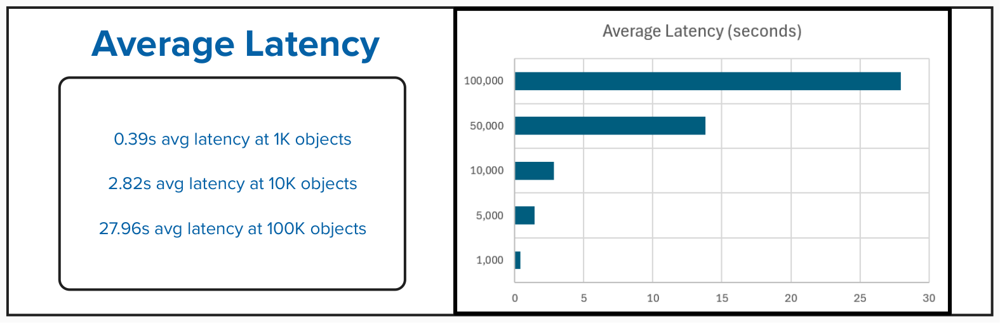

## Resharding Disruption Window at 2 Billion Objects

**Test Description:** Using elbencho, start up a steady-state mixed workload that consists of 70% GETs and 30% PUTs at the 64K object size that runs at 40% of the system's maximum throughput. Let the workload run for ~20 minutes, then issue the radosgw-admin command to manually reshard the bucket to `num_shards=25,013`. 25,000 shards was selected to target an objects per shard ratio of 80%.
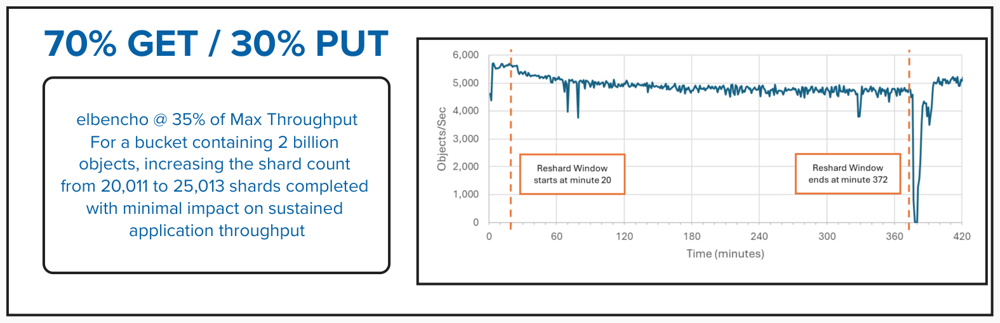
The reshard duration to go from `num-shards` 20,011 to 25,013 for 2 billion objects lasted 5 hours and 51 minutes. During the resharding period, client writes are allowed, but new objects written during this phase accumulate as "delta keys". When the resharding period completes, writes are blocked to reshard those delta keys and there is a brief period where throughput drops to near zero. This drop is considered expected behavior.

## Delete Performance at 2 Billion Objects

### Multi-Delete versus Structured-Delete

During our delete testing, we were presented with two methods of handling deletes using elbencho:

• Multi-Delete utilizes the `--s3multidel` parameter and batch deletes can range from 1-1000. Prior knowledge of the directory structure is not required. The application issues a listing of the targeted prefix contents and then processes the deletions based on the listing. It is important to note that `--s3multidel` is only a single-threaded operation with elbencho.

• Structured-Delete does not use the `--s3multidel` parameter and thus requires prior knowledge of the directory structure within the given prefix to correctly delete the objects.

**Test Description:** Delete 10 partitions of 39,600 objects each with a single RGW.
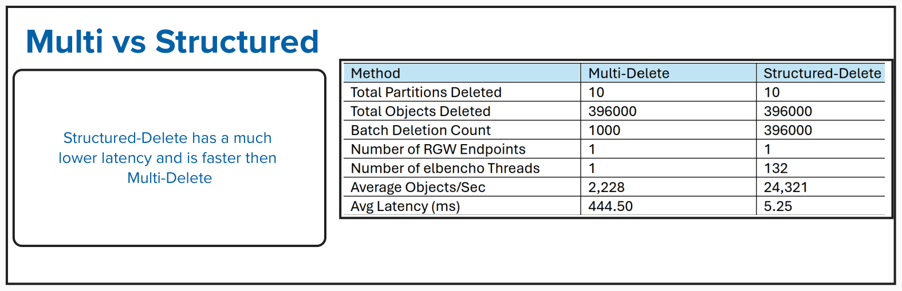
Multi-Delete is limited by the fact that it is a single-threaded operation, and it also produces high client latency since the application needs to list the objects before it can delete them. The throughput achieved with multi-delete is also considerably lower due to the lower number of threads that can be used. For the remainder of our testing, we chose to invoke Structured-Delete.

**Test Description:** Using elbencho, start up a steady-state mixed workload that consists of 70% GETs and 30% PUTs at the 64K object size. Let the workload run for 10 minutes, then issue the elbencho command to Structured-Delete 19.8 million objects.
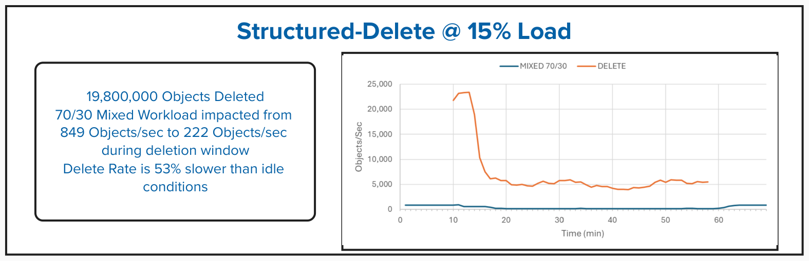
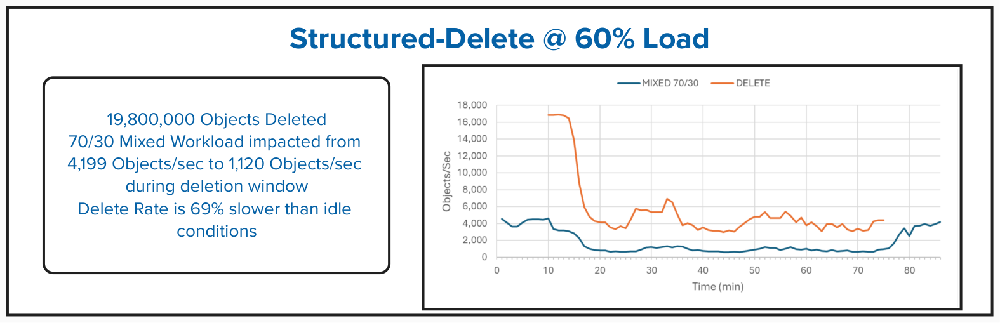
Structured-delete is faster to delete many objects because it is not only multi-threaded, but it does not require the application to list objects before deleting them. Adding host I/O will not elongate the duration of the deletion window by much. However, impact on host I/O is high since system resources are more committed to the delete operation.

## Garbage Collection at 2 Billion Objects

To properly invoke garbage collection after deletion, we created a mixed object-size profile of 2 billion small objects (size 64KB in `metadata/` and `data/`) and 10 million large objects (size 16MB in data/).

**Test Description:** Using elbencho's structured-delete method, remove 2 million 16MB objects.
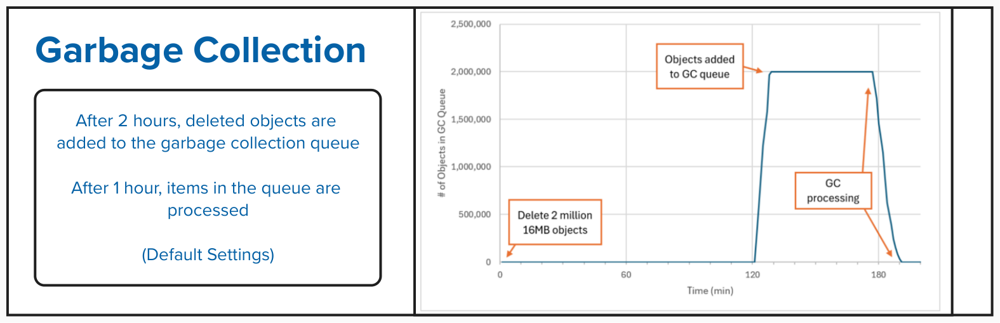
Objects are moved to the GC queue 2 hours after deletion until it is completely filled with 2 million objects due to the default setting of `rgw_gc_obj_min_wait=7200`. It took 9 minutes and 27 seconds to actually add 2 million objects to the GC queue. The system automatically processed the GC queue 60 minutes after the queue was filled due to the default setting of `rgw_gc_processor_period=3600`. It then took 15 minutes and 25 seconds to process 2 million objects in the GC queue for an average drain rate of 2,161 objects/sec.
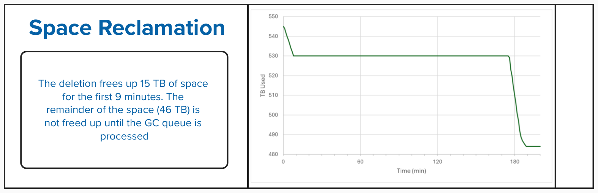

### GC Drain Rate Under Load

**Test Description:** Using elbencho, start up a steady-state mixed workload that consists of 70% GETs and 30% PUTs at the 64K object size. Let the workload run for 10 minutes, then issue the elbencho command to structured-delete 2 million 16MB objects. Let the GC queue fill fully, then process the queue manually after 10
minutes.

For this test, the following variables were adjusted to focus on drain rate performance:
```
ceph config set client.rgw rgw_gc_obj_min_wait 1800
ceph config set client.rgw rgw_enable_gc_threads false
```
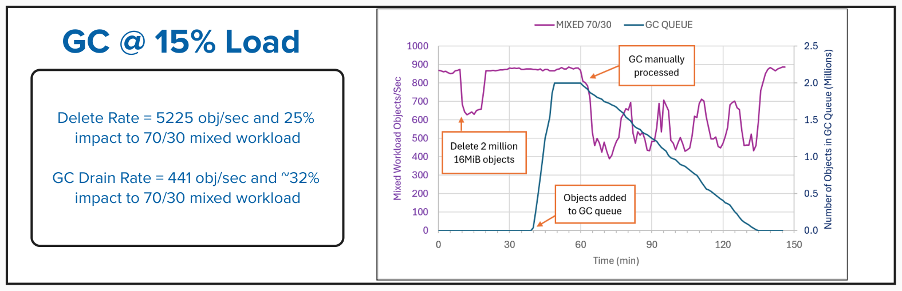
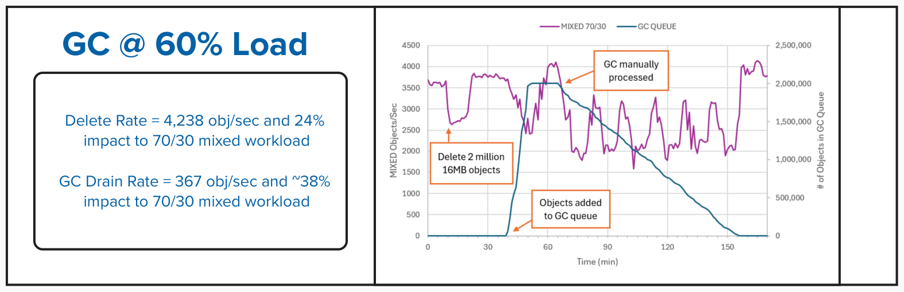
From the garbage collection tests we can see that the background load and GC processing heavily impacted each other. Once the GC process completed, the steady-state host I/O returns to the original performance from before the test began.

### Garbage Collection Tuning

Per Ceph online documentation [Ceph RGW config reference](https://docs.ceph.com/en/latest/radosgw/config-ref/), garbage collection can be tuned to be less aggressive or more aggressive.

Default GC Settings:
```
rgw_gc_max_concurrent_io=10
rgw_gc_max_trim_chunk=16
```
Settings to make GC less aggressive ("Decreased" Profile):
```
ceph config set client.rgw rgw_gc_max_concurrent_io 5
ceph config set client.rgw rgw_gc_max_trim_chunk 8
```
Settings to make GC more aggressive ("Increased" Profile):
```
ceph config set client.rgw rgw_gc_max_concurrent_io 20
ceph config set client.rgw rgw_gc_max_trim_chunk 64
```
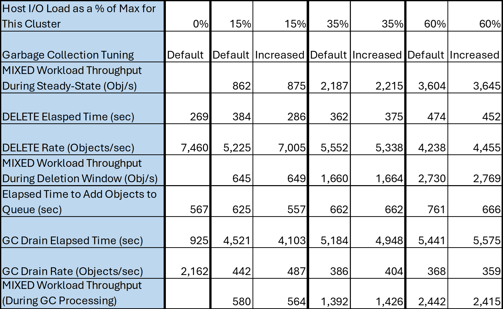
The experiments with tuning demonstrated that system resources are limited at higher background loads. Thus the GC tuning parameters of `rgw_gc_max_concurrent_io=20` and `rgw_gc_max_trim_chunk=64` are good suggestions when heavy delete workloads are expected and there is low host I/O activity. Otherwise, the default values are acceptable.

## Lifecycle Processing at 2 Billion Objects

**Test Description:** Using boto3, apply the expiration policy json to the bucket. Example:
"
```
  "Rules": [
    {
      "ID": "expire-metadata-prefix",
      "Status": "Enabled",
      "Filter": { "Prefix": "warehouse/db/table/metadata/" },
      "Expiration": { "Date": "2024-01-01T00:00:00Z" }
    }
  ]
```
With no host I/O running, process the 20 million objects manually. Track the total objects and processing rate
over time.
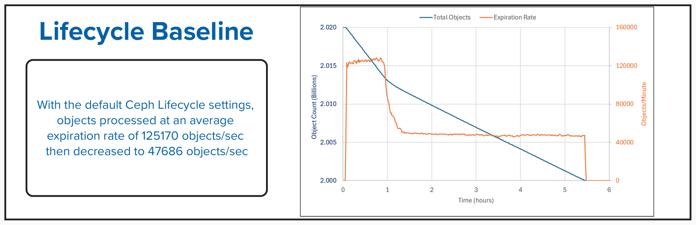

### Lifecycle Processing Under Load with Default Settings

**Test Description:** Using elbencho, start up a steady-state mixed workload that consists of 70% GETs and 30% PUTs at the 64K object size. Let the workload run for 10 minutes, then issue the boto3 command to expire 20 million objects manually.
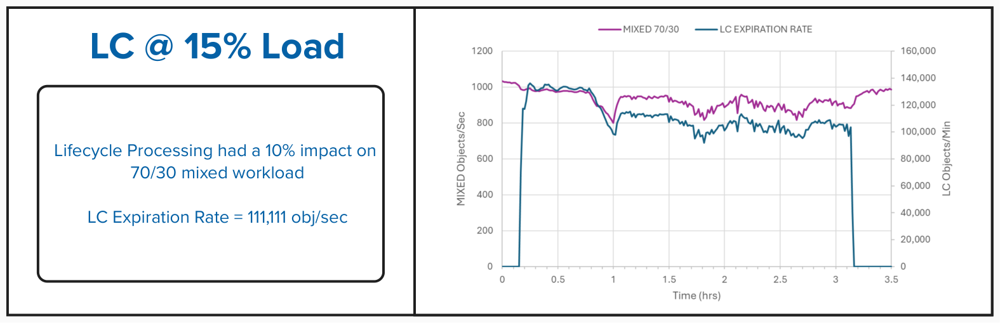
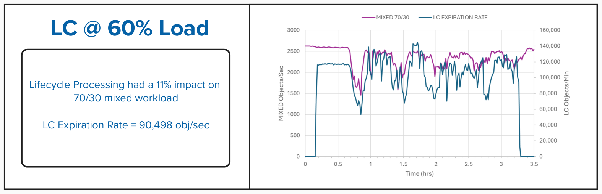
During the lifecycle processing period, host I/O was impacted by about 10% for both cases of background load.

### Tuning for Lifecycle Processing

Per Ceph online documentation [Ceph RGW config reference](https://docs.ceph.com/en/latest/radosgw/config-ref/), lifecycle processing can be tuned to be more aggressive.

The following variables were increased to observe the impact on lifecycle processing performance:
```
ceph config set client.rgw rgw_lc_max_worker X
ceph config set client.rgw rgw_lc_max_wp_worker X
```
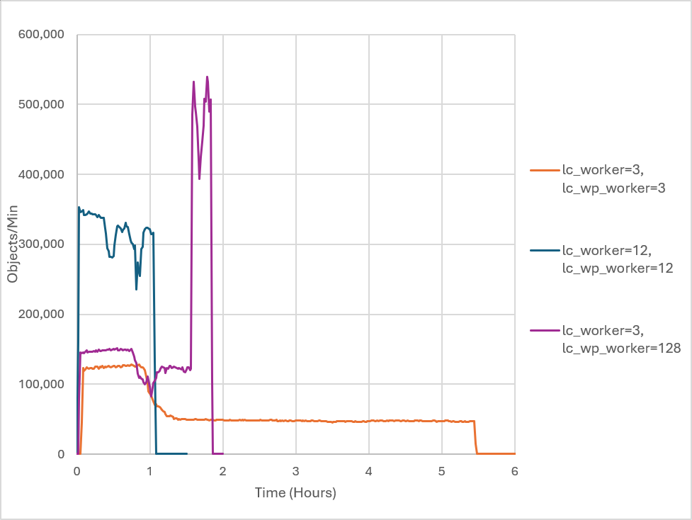

The most aggressive lifecycle processing rate was observed when the following values were set:
```
rgw_lc_max_worker=12
rgw_lc_max_wp_worker=12
```
We used these settings for the "Increased" Tuning profile in the table below.
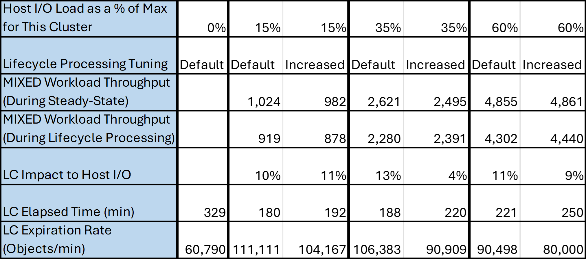
The lifecycle processing results showed that even when storing billions of objects, their effects on client workloads was minimal when dealing with object expiration. When comparing all load levels, lifecycle processing reduced mixed workload throughput by around 10-13%. LC expiration rate speeds up when there is background host I/O. However, the heavier the host I/O, the longer one can expect lifecycle processing to complete. The LC tuning parameters of rgw_lc_max_worker and rgw_lc_max_wp_worker can be modified depending on the user's goals to either limit impact to host I/O or speed up the lifecycle processing duration during idle periods. Otherwise, the default values are acceptable.

## Ceph Cluster Configuration
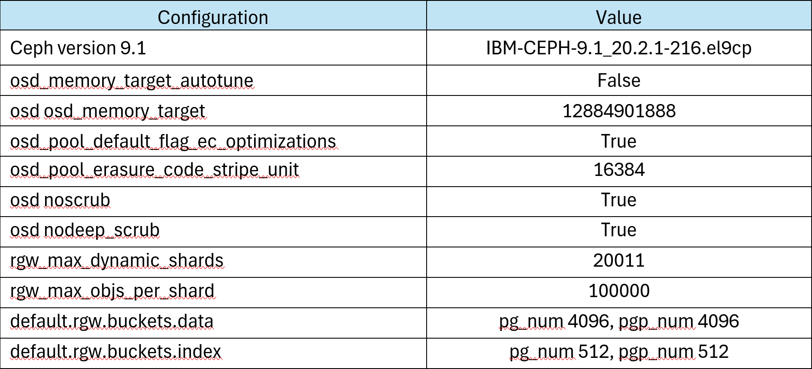

### Storage & Client Node Tunables
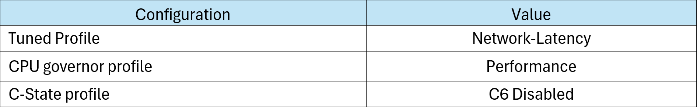

### Hardware
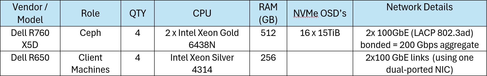

### Software
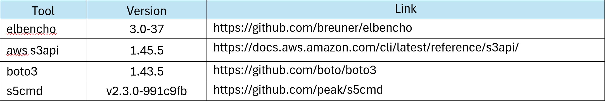

## Conclusion

This study shows that Ceph can maintain predictable performance for a large bucket with 2 billion objects. No fundamental issues were found with listing, resharding, deletion, garbage collection, and lifecycle expiration that prevented continued operation even at this large bucket size. Through the tests, it was observed that bucket size was not the limiting factor affecting performance but in fact it was limited to resources of the cluster. There was reduced throughput of object deletion and garbage collection at higher levels of background load in the environment. Lifecycle tuning showed that LC expiration rate can be increased when there is low host activity. Overall, the data gathered from these tests show that companies who build large Lakehouse, analytics, AI, and archival data can confidently scale buckets into the billions of objects.

<hr style="width: 100%; height: 2px; background-color: gray; border: none;">

Author - Andy Lin (awlin@ibm.com), Editor - Alex Surma (alexander.surma@ibm.com)
