## Intro
Object storage deployments keep growing and bucket sizes are now routinely
exceeding what were once considered generous limits. While AI, modern
analytics, and data lake workloads are pushing bucket sizes to an all-time
high, the effects on metadata performance and object list latency are becoming
concerns.

This blog explores the performance impact of configuration options, garbage 
collection, and lifecycle policy management on the common `PUT`, `LIST`, `GET`,
and `DELETE` operations. The data talked about here was taken from synthetic 
workloads on Ceph Object Gateway (RGW) to better understand the effect large 
buckets have on performance, and to learn how complex metadata is handled in
Ceph so we can create practical guidelines on how to handle buckets of this
size. The I/O driver used to generate workloads was `elbencho` unless 
otherwise specified.

Earlier posts, [Scaling Ceph RGW: A Billion Objects per
Bucket](https://community.ibm.com/community/user/blogs/vidushi-mishra/2024/07/24/scaling-ceph-rgw-a-billion-objects-per-bucket)
and [Scaling Ceph to a billion objects and
beyond](https://www.redhat.com/en/blog/scaling-ceph-billion-objects-and-beyond),
tested Ceph at the billion-object scale. This study puts 2 billion objects in a
single bucket and looks more closely at garbage collection and lifecycle
processing.

## Test Environment

4 servers were used for the Ceph storage cluster:

| Component | Specification |
| --------- | ------------- |
| Processor | 2 x 32-core server CPUs (64 cores and 128 threads in each server) |
| Memory | 512 GB RAM |
| Ceph upstream release | 20.2.1 (Tentacle) |
| Operating system | Enterprise Linux, release 10.2 |
| OS drives | 2 x 480 GB RAID-1 SSD |
| OSD drives | 16 x 15.36 TB read-intensive enterprise PCIe Gen 4 TLC NVMe SSDs |
| Network interfaces | Data: dual-port 100 GbE adapter<br>Management: 2x 1 GbE |

4 physical clients were used to drive the workload:

| Component | Specification |
| --------- | ------------- |
| Processor | Server CPU @ 2.40 GHz |
| Memory | 256 GB RAM |
| Operating system | Enterprise Linux, release 10.1 |
| Network | 2x 100 GbE links (on one dual-port 100 GbE adapter) |

*Additional environment details provided at the end of the article.*

## Creating the Objects

**Test Description:** We created a single bucket and pre-sharded it to
`num-shards=20011`. This value was used to stay below the default 
`rgw_max_objs_per_shard` value of 100000 in order to avoid resharding during
the exercise when creating 2 billion objects.  The value of 
`rgw_max_dynamic_shards` was also raised to 20011, which is above the default 
limit of 1999. Then we populated the bucket to 2 billion 64 KiB objects using a
realistic lakehouse prefix layout (e.g.
`warehouse/db/table/metadata/... and warehouse/db/table/data/partition/...`).
Dynamic resharding adds shards only to a bucket that has fewer than
`rgw_max_dynamic_shards` shards, so the bucket stayed at 20011 shards even
after the garbage collection tests below added 10 million more objects and
took it past 100000 objects per shard.
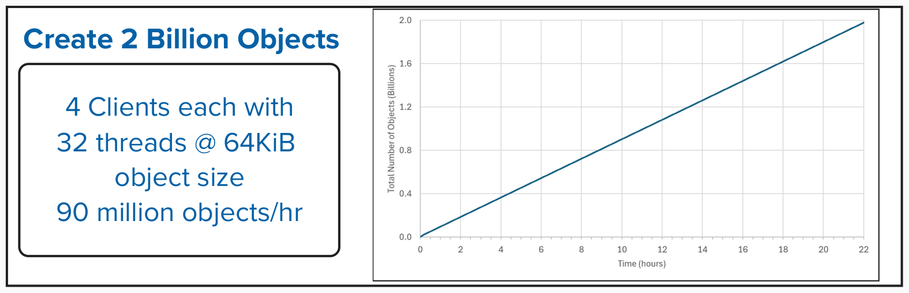

## Listing the Objects

The term "Latency" used here is the amount of time it takes for the issued
operation to complete.

**Test Description:** We ran a single CLI command with `aws s3api`, `boto3`,
`elbencho`, or `s5cmd` to return the first page of 1000 S3 objects.
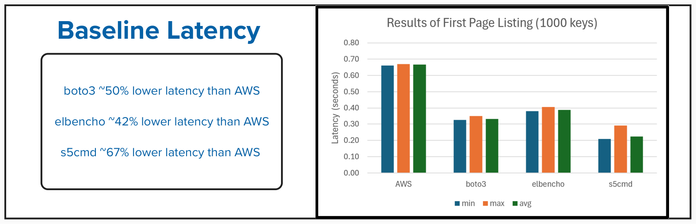
Based on the baseline latency results for the four clients used for listing
objects combined with the overall demands of workload patterns for the testing
in this document, we decided to go with `elbencho` as our primary testing driver.

**Test Description:** We ran a single `elbencho` command to return the first page
of X objects, where the value of X is between 1000 and 100000 objects.
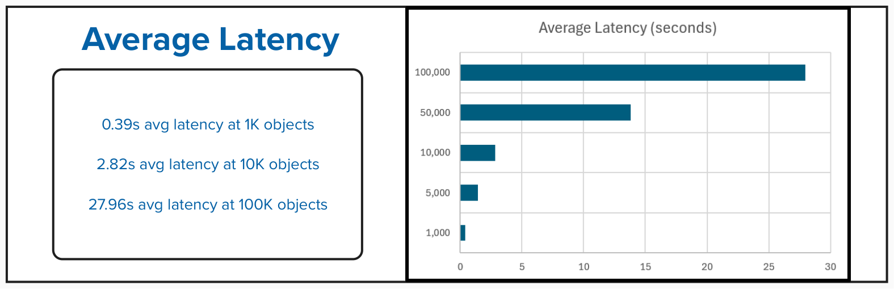

## Resharding Disruption Window at 2 Billion Objects

**Test Description:** Using `elbencho`, we started up a steady-state mixed workload
of 70% `GET` and 30% `PUT` at the 64 KiB object size. We let the workload run for 
~20 minutes, then we issued the `radosgw-admin` command to manually reshard the 
bucket to `num_shards=25013` to observe the impact resharding has on client I/O.
25013 shards was selected to target an objects per shard ratio of 80%.
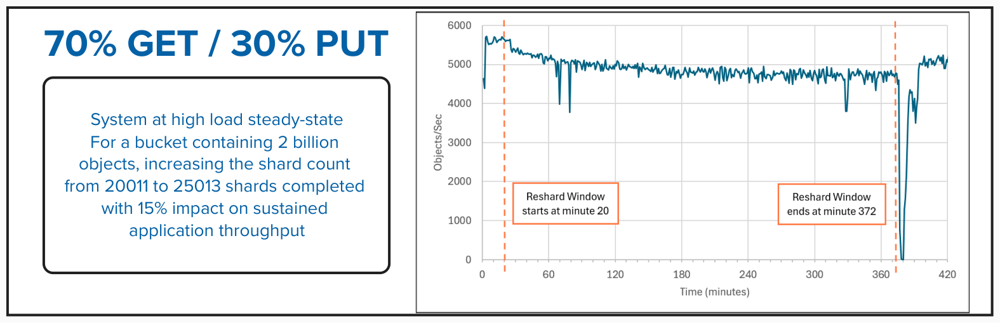
We manually resharded the bucket from 20011 to 25013, which with 2 billion
objects required an elapsed 5 hours and 51 minutes. During the reshard,
throughput dropped from about 5600 to about 4800 objects/sec, roughly 15%. At
the end of the reshard it fell to zero for several minutes. Because each
`elbencho` thread issues its requests in turn, a blocked `PUT` also holds up
that thread's `GET` requests. Beginning with the Tentacle
release, client writes are accepted during resharding: new objects accumulate
as "delta keys". When resharding completes, bucket writes are blocked while
these delta keys are integrated. This block and the concomitant drop in
performance is expected behavior. Earlier Ceph releases blocked for the entire
reshard process; this recent optimization significantly improves the client
experience during dynamic or manual resharding. For workloads where the number
of RGW objects per bucket is reasonably constant, pre-sharding the bucket may
still be beneficial. For workloads where the number of objects per bucket
varies considerably over time, dynamic resharding can enable faster `LIST`
operations when the object count is lower.

For the remainder of testing below, the bucket was recreated and populated with
the `num_shards=20011` setting.


## Delete Performance at 2 Billion Objects

### Multi-Delete versus Structured-Delete

During our delete testing, we were presented with two methods of handling
deletes using `elbencho`:

• Multi-Delete uses the `--s3multidel` parameter, which sends S3 multi-object
  delete requests of 1 to 1000 objects each. Prior knowledge of the directory
  structure is not
  required. The application issues a listing of the targeted prefix contents
  and then processes the deletions based on the listing. It is important to
  note that `--s3multidel` is a single-threaded operation with `elbencho`.

• Structured-Delete does not use the `--s3multidel` parameter and thus
  requires prior knowledge of the directory structure within the given prefix
  to correctly delete the objects.

**Test Description:** We deleted 10 partitions of 39600 objects each with a
single RGW.

| Metric | Multi-Delete | Structured-Delete |
| ------ | -----------: | ----------------: |
| Total partitions deleted | 10 | 10 |
| Total objects deleted | 396000 | 396000 |
| Objects per `DELETE` request | 1000 | 1 |
| Number of RGW endpoints | 1 | 1 |
| Number of `elbencho` threads | 1 | 132 |
| Average objects/sec | 2228 | 24321 |
| Average request latency (ms) | 444.50 | 5.25 |

These results compare 1 `elbencho` thread with 132, so they show the limit of
`elbencho`'s single-threaded `--s3multidel` mode, not of S3 multi-object delete
itself. The latencies aren't directly comparable either: a Multi-Delete request
removes up to 1000 objects, while a Structured-Delete request removes one.
Multi-Delete also produces high client latency since the application needs to
list the objects before it can delete them. Listing large buckets is always a
slow and paginated operation. Some clients or libraries issue a `LIST` before
every command, which is to be avoided.  For the remainder of our testing, we
chose to invoke Structured-Delete.

**Test Description:** Using `elbencho`, we started up a steady-state mixed workload
of 70% `GET` and 30% `PUT` at the 64 KiB object size. We let the workload run for 10
minutes, then we issued the `elbencho` command to Structured-Delete 19.8 million objects.
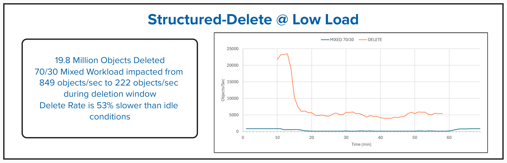
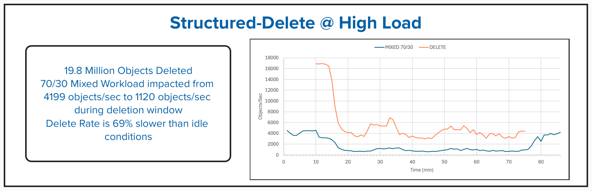
Structured-delete is faster to delete many objects because it is not only
multi-threaded, but it also does not require the application to list objects before
deleting them. Adding client I/O will elongate the duration of the deletion
window. However, impact on client I/O is high since system resources are
more committed to the delete operation.

## Garbage Collection at 2 Billion Objects

RGW stores up to `rgw_max_chunk_size` (4 MiB by default) of an object's data
in its head object and the rest in tail objects. Deleting an object removes the
head right away and sends only the tail objects to garbage collection (GC), so
deleting 64 KiB objects never involves GC. To exercise GC, we created a mixed
object-size profile of 2 billion small objects (64 KiB, in `metadata/` and
`data/`) and 10 million large objects (16 MiB, in `data/`).

**Test Description:** Using the structured-delete method with `elbencho`, we removed
2 million 16 MiB objects.
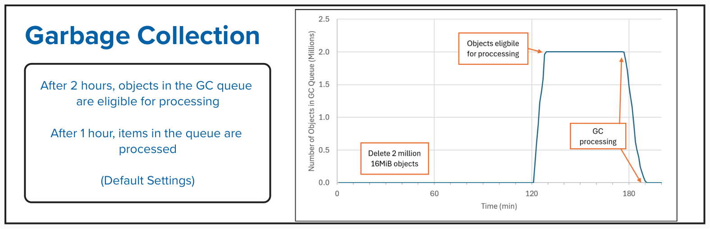
The deleted objects entered the GC queue as soon as they were deleted, but each
entry becomes eligible for processing only after `rgw_gc_obj_min_wait` (7200
seconds, or 2 hours, by default). The chart counts eligible entries, which is
also what `radosgw-admin gc list` shows unless you add `--include-all`, so the
queue appears to fill 2 hours after the deletion. GC runs every
`rgw_gc_processor_period` (3600 seconds by default), so eligible entries can
wait up to another hour; here processing began about an hour after they became
eligible. The average drain rate of the GC queue was 2161 objects/sec, which
took 15 minutes and 25 seconds to be fully emptied.
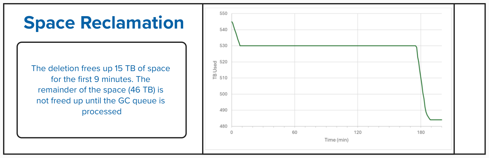

### GC Drain Rate Under Load

**Test Description:** Using `elbencho`, we started up a steady-state mixed workload
of 70% `GET` and 30% `PUT` at the 64 KiB object size. We let the workload run for 10
minutes, then we issued the `elbencho` command to structured-delete 2 million 16 MiB
objects. We let the GC queue fill, then 10 minutes later we drained it manually with
`radosgw-admin gc process`.

For this test, the following variables were adjusted to focus on drain rate
performance:
```
ceph config set client.rgw rgw_gc_obj_min_wait 1800
ceph config set client.rgw rgw_enable_gc_threads false
```
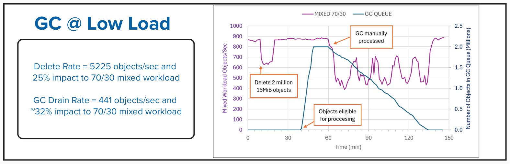
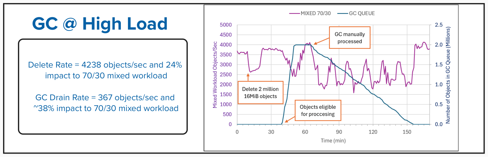
From the garbage collection tests we saw that the background load and GC
processing heavily impacted each other. Once the GC process completed, the
steady-state client I/O returned to the original performance from before the test
began.

### Garbage Collection Tuning

Per Ceph online documentation [Ceph RGW config
reference](https://docs.ceph.com/en/latest/radosgw/config-ref/), garbage
collection can be tuned to be less aggressive or more aggressive.

Default GC Settings:
```
rgw_gc_max_concurrent_io=10
rgw_gc_max_trim_chunk=16
```
Settings used to make GC more aggressive ("Increased" Profile):
```
ceph config set client.rgw rgw_gc_max_concurrent_io 20
ceph config set client.rgw rgw_gc_max_trim_chunk 64
```

| Client I/O Load | None | Low | Low | Medium | Medium | High | High |
| -------------------------------------------- | -: | --: | --: | --: | --: | --: | --: |
| **Garbage Collection Tuning** | **Default** | **Default** | **Increased** | **Default** | **Increased** | **Default** | **Increased** |
| Mixed workload throughput during steady-state (obj/s) | - | 862 | 875 | 2187 | 2215 | 3604 | 3645 |
| `DELETE` elapsed time (sec) | 269 | 384 | 286 | 362 | 375 | 474 | 452 |
| `DELETE` rate (objects/sec) | 7460 | 5225 | 7005 | 5552 | 5338 | 4238 | 4455 |
| Mixed workload throughput during deletion window (obj/s) | - | 645 | 649 | 1660 | 1664 | 2730 | 2769 |
| Elapsed time for all entries to show in the GC queue (sec) | 567 | 625 | 557 | 662 | 662 | 761 | 666 |
| GC drain elapsed time (sec) | 925 | 4521 | 4103 | 5184 | 4948 | 5441 | 5575 |
| GC drain rate (objects/sec) | 2161 | 442 | 487 | 386 | 404 | 368 | 359 |
| Mixed workload throughput during GC processing (obj/s) | - | 580 | 564 | 1392 | 1426 | 2442 | 2415 |

The experiments with tuning demonstrated that system resources are limited at
higher background loads. The "Increased" profile shortened the GC drain by
about 9% at low load and about 5% at medium load, and it was about 2% slower at
high load. GC tuning can't affect the `DELETE` rows, because no GC processing
happens during the deletion, so the differences between columns in those rows,
as much as 25%, show how much results vary from run to run. The table has no
run of the "Increased" profile without client load. The GC tuning parameters
of `rgw_gc_max_concurrent_io=20` and `rgw_gc_max_trim_chunk=64` may help when
heavy delete workloads are expected and client I/O is low, but these results
don't show a clear benefit under load. Otherwise, the default values are
acceptable.

### Additional Recommendations for Deploying RGW Instances Dedicated to GC Processing
**For Production-Facing RGWs:** Disable GC processing entirely to dedicate all thread
and CPU resources to client S3/Swift API traffic. In these examples,
`client.rgw.<service_id>` applies to every RGW daemon of that service.
```
ceph config set client.rgw.<frontend_service_id> rgw_enable_gc_threads false
```

**For Dedicated GC RGWs:** Deploy separate RGW instances (which do not receive user
traffic via your load balancer) and ensure their GC loops are active.
```
ceph config set client.rgw.<gc_service_id> rgw_enable_gc_threads true
```
At least one RGW in each zone must have `rgw_enable_gc_threads` set to
`true`, or you must run `radosgw-admin gc process` yourself. Otherwise the
space that deleted objects used is never reclaimed.

## Lifecycle Processing at 2 Billion Objects

**Test Description:** Using `boto3`, we applied the LC expiration policy to the
bucket. Example:
```
  "Rules": [
    {
      "ID": "expire-metadata-prefix",
      "Status": "Enabled",
      "Filter": { "Prefix": "warehouse/db/table/metadata/" },
      "Expiration": { "Date": "2024-01-01T00:00:00Z" }
    }
  ]
```
With no client workload running, we ran `radosgw-admin lc process` to expire the 
20 million objects.  We then tracked the total objects and processing rate over time.
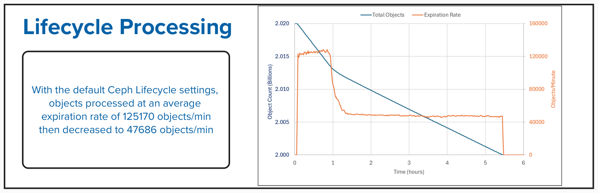

### Lifecycle Processing Under Load with Default Settings

**Test Description:** Using `elbencho`, we started up a steady-state mixed workload
of 70% `GET` and 30% `PUT` at the 64 KiB object size. We let the workload run for 
10 minutes, then we issued the `boto3` command to apply the expiration policy and 
ran `radosgw-admin lc process` to expire the 20 million objects.
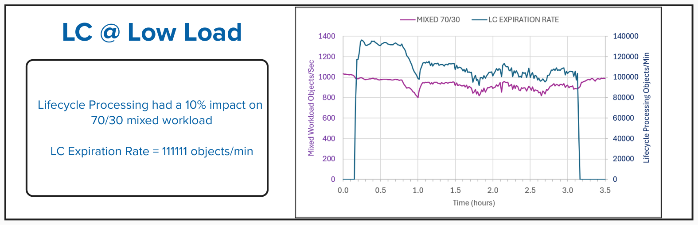
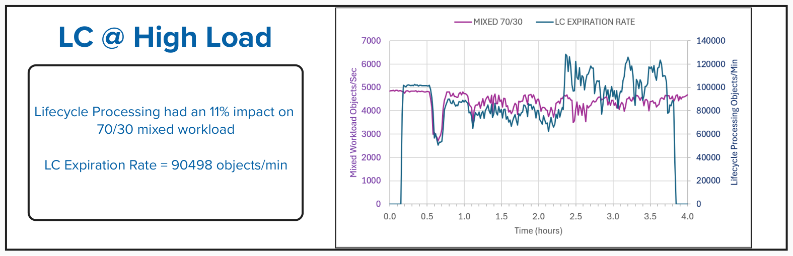
With default settings, lifecycle processing finished sooner under load
(180 to 221 minutes) than with no load (329 minutes). We repeated the
no-load test and saw the same pattern each time: about 125000 objects/min
for the first hour, then a slower rate of 47000 objects/min for the rest 
of the run. We did not find an explanation. The no-load time is therefore a 
result for this setup, not a fixed baseline.

### Tuning for Lifecycle Processing

Per Ceph online documentation [Ceph RGW config
reference](https://docs.ceph.com/en/latest/radosgw/config-ref/), lifecycle
processing can be tuned to be more aggressive.

The following variables were increased to observe the impact on lifecycle
processing performance:
```
ceph config set client.rgw rgw_lc_max_worker X
ceph config set client.rgw rgw_lc_max_wp_worker X
```
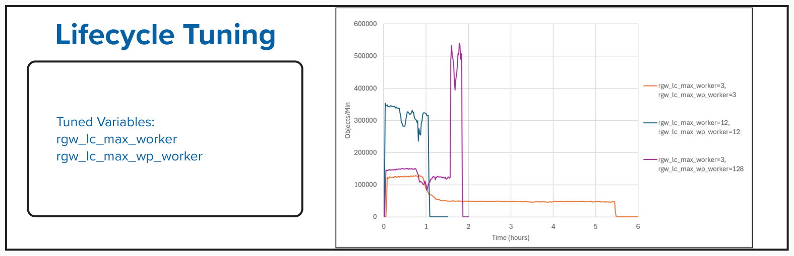

With no client load, the shortest total runtime, about an hour, was observed
when the following values were set:
```
rgw_lc_max_worker=12
rgw_lc_max_wp_worker=12
```
The run with `rgw_lc_max_worker=3` and `rgw_lc_max_wp_worker=128` reached the
highest peak rate, about 530000 objects/min, but took about 1.9 hours in all.
The defaults took about 5.5 hours. We used the 12 and 12 settings for the
"Increased" Tuning profile in the table below.

These values are for Tentacle, where `rgw_lc_max_wp_worker` defaults to 3.
Beginning with the Umbrella release, it defaults to 128, so setting it to 12
there would lower it.

| Client I/O Load | None | Low | Low | Medium | Medium | High | High |
| -------------------------------------------- | -: | --: | --: | --: | --: | --: | --: |
| **Lifecycle Processing Tuning** | **Default** | **Default** | **Increased** | **Default** | **Increased** | **Default** | **Increased** |
| Mixed workload throughput (during steady-state) | - | 1024 | 982 | 2621 | 2495 | 4855 | 4861 |
| Mixed workload throughput (during lifecycle processing) | - | 919 | 878 | 2280 | 2391 | 4302 | 4440 |
| LC impact to client I/O | - | 10% | 11% | 13% | 4% | 11% | 9% |
| LC elapsed time (min) | 329 | 180 | 192 | 188 | 220 | 221 | 250 |
| LC expiration rate (objects/min) | 60790 | 111111 | 104167 | 106383 | 90909 | 90498 | 80000 |

The lifecycle processing results showed that even when storing billions of
objects, their effects on client workloads were modest when dealing with
object expiration. With default settings, lifecycle processing reduced mixed
workload throughput by 10% to 13%, and with the "Increased" profile by 4% to
11%. The heavier the client I/O, the longer lifecycle processing took.  The
"Increased" profile took longer than the defaults at every level: 192 versus
180, 220 versus 188, and 250 versus 221 minutes. Its benefit was with no load,
where it finished in about an hour. Raising `rgw_lc_max_worker` and
`rgw_lc_max_wp_worker` can speed up lifecycle processing during idle periods;
otherwise, the default values are acceptable.

### Additional Recommendations for Deploying RGW Instances Dedicated to LC Processing
**For Production-Facing RGWs:** Disable LC processing entirely to dedicate all
thread and CPU resources to client S3/Swift API traffic.
```
ceph config set client.rgw.<frontend_service_id> rgw_enable_lc_threads false
```

**For Dedicated LC RGWs:** Deploy separate RGW instances (which do not receive
user traffic via your load balancer) and ensure their LC threads are active.
You can also widen the LC work window and raise the worker counts on these
instances. On Umbrella and later, leave `rgw_lc_max_wp_worker` at its default.
```
ceph config set client.rgw.<lc_service_id> rgw_enable_lc_threads true
ceph config set client.rgw.<lc_service_id> rgw_lifecycle_work_time 00:00-23:59
ceph config set client.rgw.<lc_service_id> rgw_lc_max_worker 12
ceph config set client.rgw.<lc_service_id> rgw_lc_max_wp_worker 12
```
At least one RGW in each zone must have `rgw_enable_lc_threads` set to
`true`. If the parameter is disabled on every RGW, no lifecycle processing
happens.

**LC Schedule:** By default, LC processing starts once a day and runs only
during a daily work window, set by `rgw_lifecycle_work_time` (default
`00:00-06:00`). When it finishes, it waits for the next window. For heavy
workloads, expect LC processing of a large number of expirations or
transitions to span multiple days.

## Ceph Cluster Configuration

| Configuration | Value |
| ------------- | ----- |
| Upstream Ceph release | 20.2.1 (Tentacle) |
| `osd_memory_target_autotune` | False |
| `osd_memory_target` | 12884901888 |
| `osd_pool_default_flag_ec_optimizations` | True |
| `osd_pool_erasure_code_stripe_unit` | 16384 |
| `osd noscrub` | True |
| `osd nodeep_scrub` | True |
| `rgw_max_dynamic_shards` | 20011 |
| `rgw_max_objs_per_shard` | 100000 |
| Data pool protection | Erasure coding, k=2 m=2 |
| Index pool protection | Replicated, size 3 |
| `default.rgw.buckets.data` | pg_num 4096, pgp_num 4096 |
| `default.rgw.buckets.index` | pg_num 512, pgp_num 512 |
| `pg_autoscale_mode` | off (both pools) |
| `mon_max_pg_per_osd` | 300 |
| RGW daemons | 16 (4 on each of the 4 storage servers, co-located with the OSDs) |

Scrubbing was disabled to keep it out of the measurements. Don't disable it in
production.

The `elbencho` clients connected directly to the 16 RGW endpoints. No load
balancer or proxy was used, so the results don't include one.

### Storage & Client Node Tunables

| Configuration | Value |
| ------------- | ----- |
| Tuned profile | `network-latency` |
| CPU governor profile | `performance` |
| C-State profile | `C6 Disabled` |

### Hardware

| Role | Qty | CPU | RAM (GB) | NVMe OSDs | Network |
| ---- | --: | --- | -------: | --------- | ------- |
| Ceph | 4 | 2 x 32-core server CPUs (64 cores and 128 threads in each server) | 512 | 16 x 15.36 TB read-intensive enterprise PCIe Gen 4 TLC NVMe SSDs | 2x 100 GbE bonded with LACP (802.3ad), 200 Gbps aggregate |
| Client machines | 4 | Server CPU @ 2.40 GHz | 256 | - | 2x 100 GbE links (on one dual-port adapter) |  

### Software

| Tool | Version |
| ---- | ------- |
| [`elbencho`](https://github.com/breuner/elbencho) | 3.0-37 |
| [`aws s3api`](https://docs.aws.amazon.com/cli/latest/reference/s3api/) | 1.45.5 |
| [`boto3`](https://github.com/boto/boto3) | 1.43.5 |
| [`s5cmd`](https://github.com/peak/s5cmd) | v2.3.0-991c9fb |

## Conclusion

This study shows that Ceph can maintain reasonable performance for a large
bucket with 2 billion objects. No fundamental issues were found with listing,
resharding, deletion, garbage collection, and lifecycle expiration that
prevented continued operation even at this large bucket size. Through the
tests, it was observed that bucket size was not the limiting factor affecting
performance but in fact it was limited to resources of the cluster. There was
reduced throughput of object deletion and garbage collection at higher levels
of background load in the environment. Lifecycle tuning showed that LC
expiration rate can be increased when there is low client I/O. Overall, the
data gathered from these tests show that companies who build large lakehouse,
analytics, AI, and archival data can confidently scale buckets into the
billions of objects.

<hr style="width: 100%; height: 2px; background-color: gray; border: none;">

Author - Andy Lin (awlin@ibm.com), Editor - Alex Surma (alexander.surma@ibm.com)
