Modern cloud-native applications increasingly rely on **event-driven
architectures** — systems that react to changes in real time rather than polling
for updates. Ceph's RADOS Gateway (RGW), the S3-compatible object storage layer
in Ceph, supports **Bucket Notifications**, a powerful mechanism to push event
information to external endpoints whenever objects are created, modified, or
deleted in a bucket.

This blog post dives deep into how Ceph RGW bucket notifications work, what
events you can subscribe to, how filters allow fine-grained control, and how the
Ceph Dashboard UI makes managing notifications easier than ever. The Dashboard
pages shown here are available beginning with the Tentacle release.

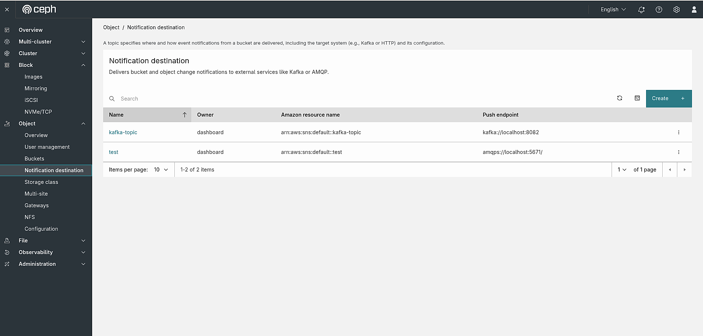

## What Are Bucket Notifications?

### Fundamental Concepts

- Bucket Notifications allow an S3 bucket to **automatically publish event
  data** to configured destinations (called _topics_) whenever specific
  operations occur on objects inside that bucket. This is the same model used by
  AWS S3 event notifications — and Ceph RGW implements a compatible API.

- The core workflow looks like this:

```
  Object operation (PUT/DELETE/COPY)
        │
        ▼
  Ceph RGW Bucket
        │  (matches event + filters)
        ▼
  Notification Topic (AMQP / Kafka / HTTP)
        │
        ▼
  External Consumer / Microservice
```

Common uses include:

- **Image processing pipelines** — trigger a Lambda/worker when a new image is
  uploaded.
- **Data ingestion** — notify a Kafka consumer when a new dataset file arrives.
- **Audit and compliance** — log every object deletion event to an external
  SIEM.
- **Cache invalidation** — invalidate CDN cache when an asset is overwritten.

Now let's see how we can configure and set up a topic with the step-by-step
guide below.

## 1. Creating a Notification Destination

Before you can attach a notification to a bucket, you need to create a **Topic**
— the destination endpoint that receives the event data.

The Ceph Dashboard supports three types of topic endpoints:

| Endpoint Type  | Protocol                | Description                            |
| -------------- | ----------------------- | -------------------------------------- |
| **AMQP**       | `amqp://`               | RabbitMQ or any AMQP-compatible broker |
| **Kafka**      | `kafka://`              | Apache Kafka topics                    |
| **HTTP/HTTPS** | `http://` or `https://` | Any webhook-compatible HTTP endpoint   |

Topics are created using the AWS SNS-compatible API exposed by RGW (`POST /`
with `Action=CreateTopic`), or through the Ceph Dashboard's **Notification
destination** management interface.

To get started, navigate to **Object → Notification destination** in the Ceph
Dashboard sidebar. This page lists all existing notification destinations and
allows you to create new ones.

Click the **Create** button in the top-right corner. You'll be prompted to fill
in the following fields:

- **Name**: A unique identifier for this destination (e.g., `kafka-topic`).
- **Owner**: The RGW user who owns this topic (e.g., `dashboard`).
- **Type**: The push endpoint type — supported options include **Kafka**,
  **AMQP**, and **HTTP**.
- **Push endpoint**: The URL of the external service that will receive the
  notifications. Its scheme matches the type, for example
  `kafka://localhost:9082` for Kafka.

Once submitted, the new destination will appear in the table with its **Name**,
**Owner**, **Amazon resource name** (ARN), and **Push endpoint**. RGW generates
the ARN in the format `arn:aws:sns:<zonegroup>:<tenant>:<name>`, so a topic
created by a user without a tenant in the `default` zonegroup is
`arn:aws:sns:default::<name>`.

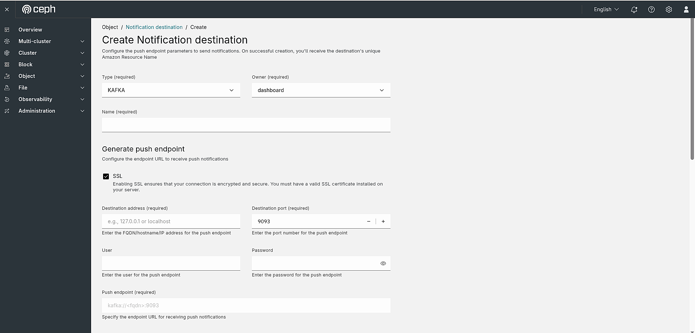
_Figure: Step 1 - Filling in the basic fields (Type, Owner, Name) and
configuring the push endpoint._

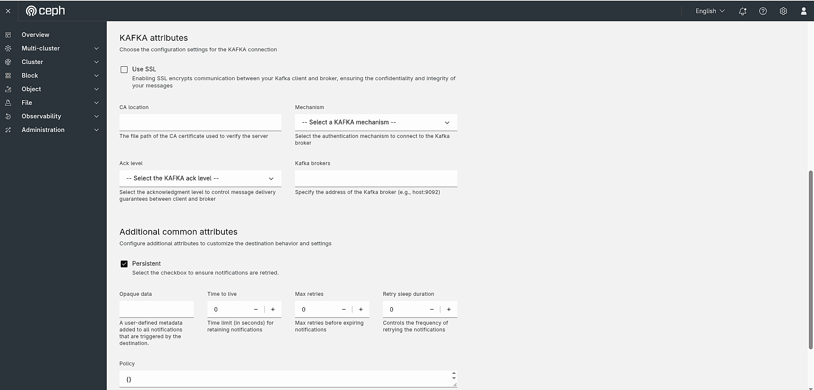
_Figure: Step 2 - Configuring endpoint-specific attributes (e.g., Kafka brokers,
SSL, ACK level)._

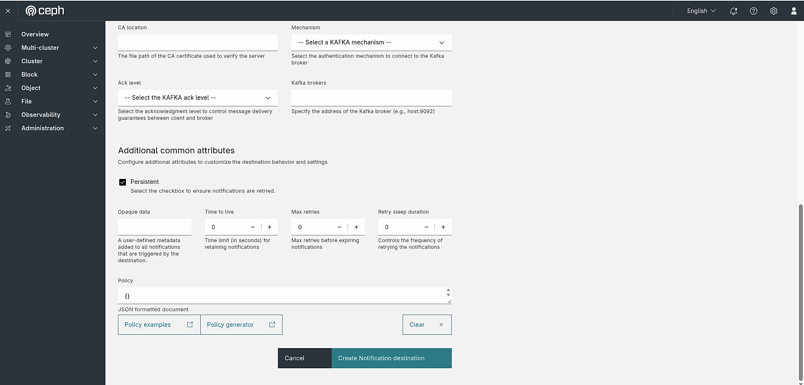
_Figure: Step 3 - Setting additional common attributes (Persistent, TTL, Max
retries) and submitting._

## 2. Exploring the Notification Destination Detail View

Once a notification destination is created, you can click on its name in the
list to open its **detail view**. The detail page for a topic (e.g.,
`kafka-topic`) is organized into three tabs:

- **Overview** — shows the topic's core properties (name, owner, push endpoint,
  ARN).
- **Policies** — shows the topic's access policy.
- **Subscribed buckets** — lists all buckets that have an active notification
  linked to this destination.

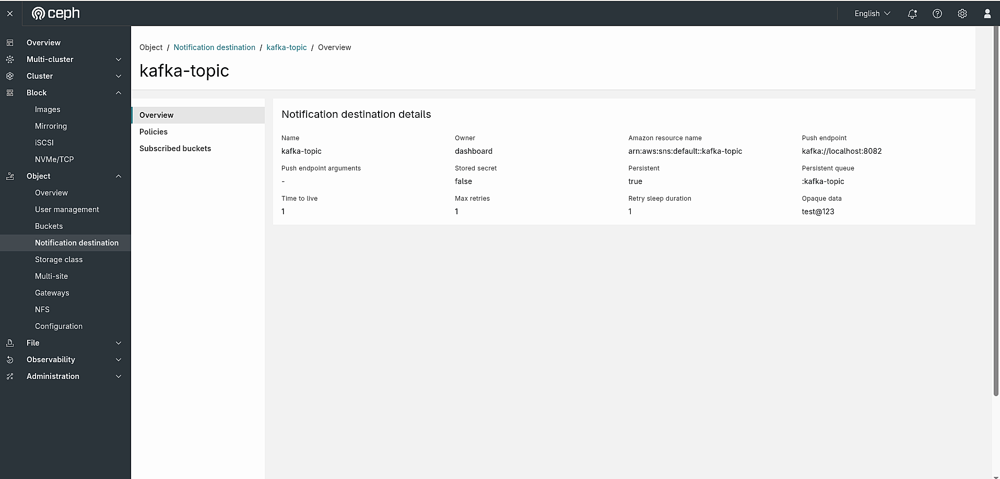
_Figure: Detail view of `kafka-topic` showing the Overview, Policies, and
Subscribed buckets tabs._

### Policies Tab

The **Policies** tab shows the topic's access policy, a JSON document similar
to a bucket policy. It controls which users other than the owner can use the
topic, for example to read its attributes (`sns:GetTopicAttributes`) or to
attach bucket notifications to it (`sns:Publish`). Each row shows a **Key** and
its corresponding **Value**.

This topic has no policy, so the `Policy` field shows `{}`, an empty JSON
object. Configuring bucket notifications doesn't change the policy. By default,
other users can attach notifications to a topic that has no policy; set
`rgw_topic_require_publish_policy` to `true` to require one.

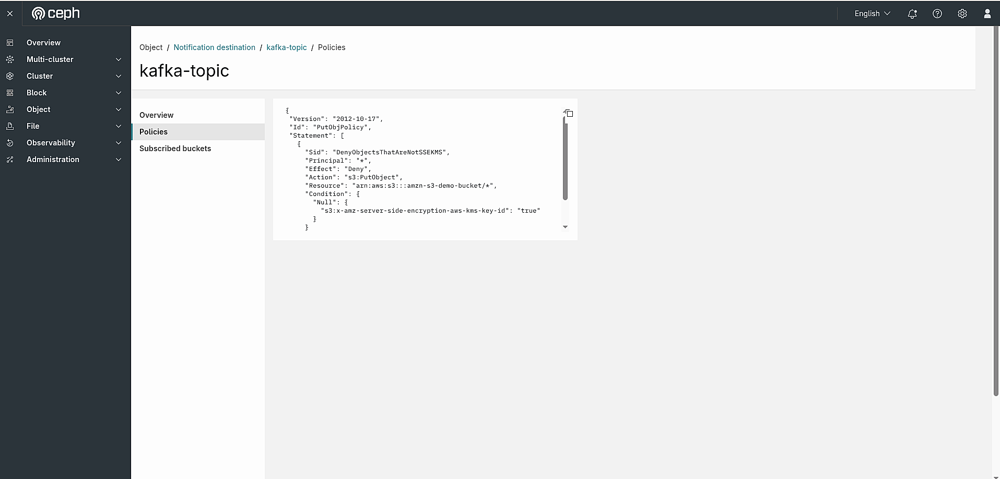
_Figure: Policies tab for `kafka-topic` showing an empty policy._

### Subscribed Buckets Tab

The **Subscribed buckets** tab shows which buckets are actively sending event
notifications to this destination. This list will be empty until a bucket
notification is created and linked to this topic.

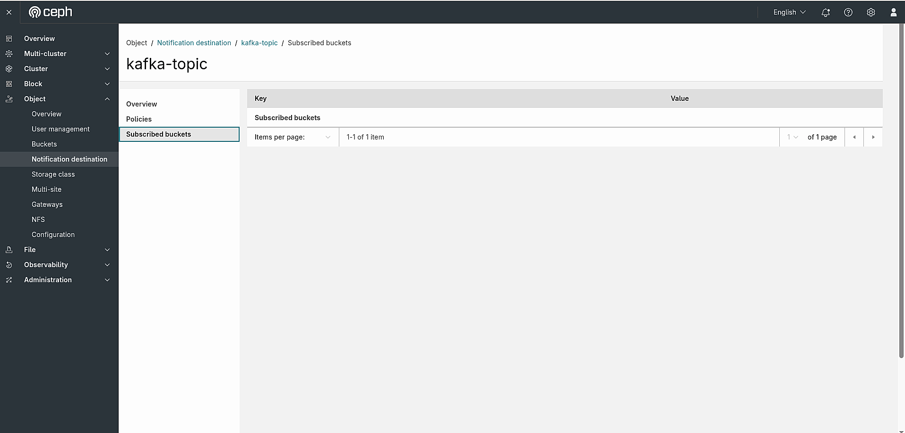
_Figure: Subscribed buckets tab for `kafka-topic` showing no buckets subscribed
yet._

The list fills in automatically once you configure a bucket notification that
references this destination, as described in section 4.

## 3. Managing a Notification Destination

In addition to creating notification destinations, the Ceph Dashboard also lets
you **edit** and **delete** them at any time from the **Object → Notification
destination** list page.

### Editing a Notification Destination

To edit an existing destination, click the **⋮** action menu on the right side
of the destination row and select **Edit**. This opens the **Edit Notification
destination** form, which is pre-populated with the current values and exposes
the full set of configuration options:

**Basic fields** (read-only after creation):

- **Type** — the endpoint protocol: `HTTP`, `Kafka`, or `AMQP`.
- **Owner** — the RGW user that owns this topic (e.g., `dashboard`).
- **Name** — the unique topic name (e.g., `kafka-topic`).

**Generate push endpoint** — builds the push endpoint URL from individual
components:

- **SSL** — encrypt the connection to the endpoint.
- **Verify SSL** — enforce server certificate validation (requires a valid SSL
  certificate).
- **Cloud events** — for HTTP endpoints, add the HTTP headers defined by the S3
  CloudEvents specification to each notification.
- **Destination address** — the FQDN or IP of the target service (e.g.,
  `localhost`).
- **Destination port** — the port number (e.g., `9082`); the final **Push
  endpoint** URL is assembled automatically (e.g., `kafka://localhost:9082`).

**Additional common attributes** — fine-tune delivery behavior:

- **Persistent** — when checked, RGW commits each notification to a queue and
  sends it asynchronously, retrying until the destination acknowledges it. When
  unchecked, RGW sends each notification as part of the operation that triggered
  it, which adds the round trip to that operation's latency, and doesn't retry.
- **Opaque data** — user-defined metadata attached to every notification sent by
  this destination.
- **Time to live** — time limit in seconds for retaining undelivered
  notifications. Persistent topics only.
- **Max retries** — maximum number of delivery attempts before a notification is
  discarded. Persistent topics only.
- **Retry sleep duration** — delay in seconds between consecutive retry
  attempts. Persistent topics only.
- **Policy** — a JSON-formatted access policy document for this topic. Use the
  **Policy examples** or **Policy generator** links to build a valid policy.

Once you have made your changes, click **Edit Notification destination** to save
them.

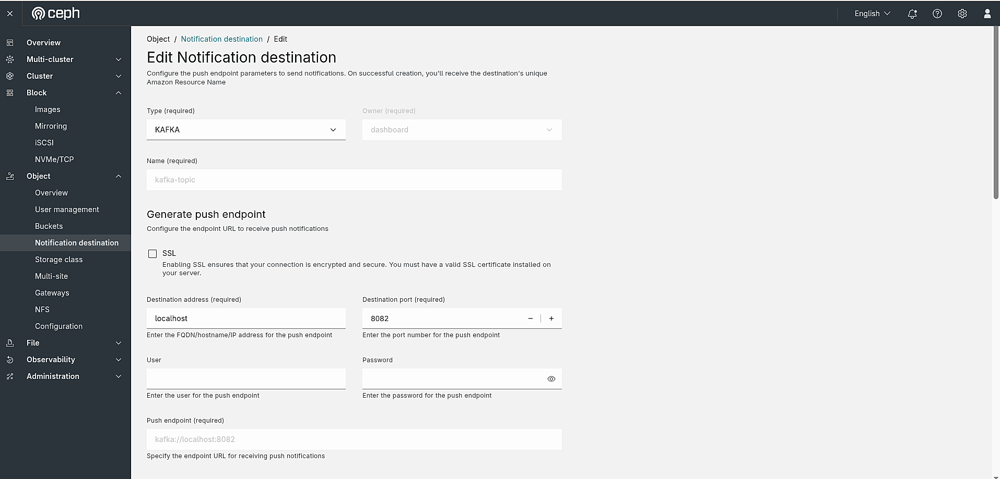
_Figure: Edit Notification destination form — basic fields and Generate push
endpoint section for `kafka-topic`._

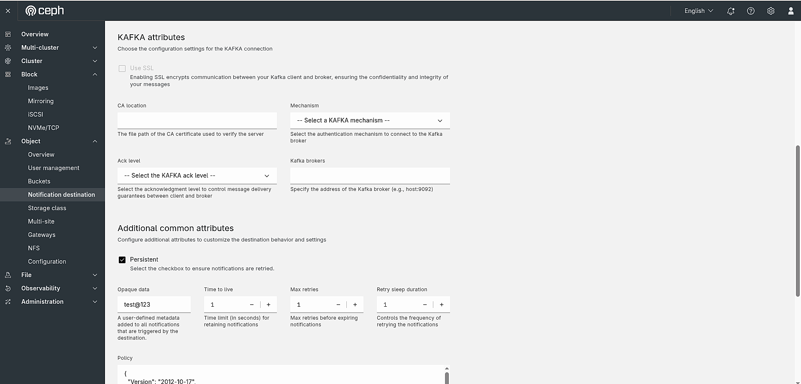
_Figure: Edit Notification destination form — endpoint-specific attributes
(Kafka/AMQP/HTTP) section._

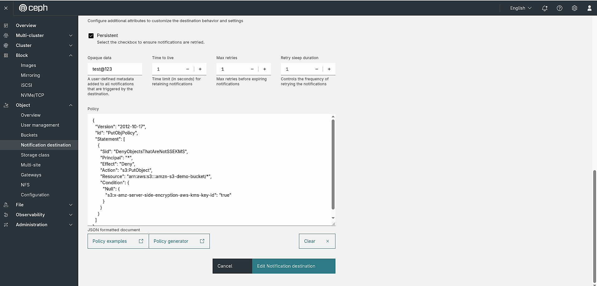
_Figure: Edit Notification destination form — Additional common attributes
(Persistent, TTL, Max retries, Policy)._

### Deleting a Notification Destination

To delete a destination, click the **⋮** action menu on the destination row and
select **Delete**. A confirmation dialog will appear asking:

> **Delete Notification destination**
> Are you sure that you want to delete **kafka-topic**?

The **Delete Notification destination** button is intentionally disabled until
you check the **"Yes, I am sure."** checkbox — this two-step confirmation
prevents accidental deletion. Once checked, the button turns red and becomes
active. Click it to permanently remove the destination.

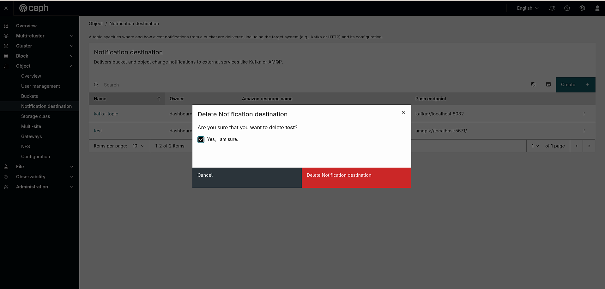
_Figure: Delete Notification destination confirmation dialog for `kafka-topic`,
requiring the "Yes, I am sure." checkbox before the Delete button activates._

> **Note:** Deleting a notification destination does not automatically remove
> bucket notifications that reference it. Make sure no active bucket
> notifications are using this topic before deleting it, otherwise those
> notifications will silently fail.

## 4. Notification Configuration

With the notification destination created, the next step is to attach a
**Notification configuration** to a specific bucket. This wires a bucket's
object events to the topic so that RGW will push a notification every time a
matching event occurs. Each bucket can have multiple independent notification
configurations targeting different topics and event types.

Navigate to **Object → Buckets**, click on the bucket name (e.g., `testbucket`),
and select the **Notifications** tab in the left sidebar. Click the **Create**
button to open the **Create Notification configuration** dialog.

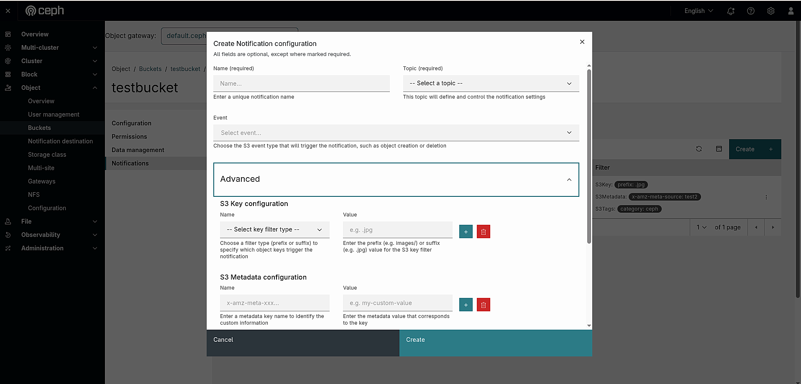
_Figure: Create Notification configuration dialog for `testbucket`, showing the
Name, Topic, Event, and Advanced filter fields._

> All fields are optional, except where marked required.

### Required Fields

| Field     | Description                                                                                                                          |
| --------- | ------------------------------------------------------------------------------------------------------------------------------------ |
| **Name**  | A unique name for this notification configuration.                                                                                   |
| **Topic** | Select the notification destination (topic) that will receive the events. This topic defines and controls the notification settings. |

### Event

| Field     | Description                                                                                                                                    |
| --------- | ---------------------------------------------------------------------------------------------------------------------------------------------- |
| **Event** | Choose the S3 event type that will trigger this notification (e.g., object creation, object deletion). Leave empty to receive all event types. |

### Advanced Filters

Expand the **Advanced** section to apply fine-grained filters that control which
specific objects trigger the notification. All filter fields accept multiple
entries using the **+** button.

#### S3 Key Configuration

Filters notifications by object key name using a **prefix** or **suffix** match.

| Field     | Description                                                                                                   |
| --------- | ------------------------------------------------------------------------------------------------------------- |
| **Name**  | Select the filter type — `prefix` to match the start of the key, or `suffix` to match the end (e.g., `.jpg`). |
| **Value** | The prefix or suffix value to match against object keys (e.g., `images/` for a prefix, `.jpg` for a suffix).  |

#### S3 Metadata Configuration

Filters notifications based on custom object metadata headers.

| Field     | Description                                             |
| --------- | ------------------------------------------------------- |
| **Name**  | The metadata key name (e.g., `x-amz-meta-environment`). |
| **Value** | The metadata value to match (e.g., `my-custom-value`).  |

#### S3 Tags Configuration

Filters notifications based on object tags.

| Field     | Description                                   |
| --------- | --------------------------------------------- |
| **Name**  | The tag key to match (e.g., `backup-status`). |
| **Value** | The tag value to match (e.g., `completed`).   |

Click **Create** to save the notification configuration. Once created, it will
appear in the **Notifications** table for that bucket with the following
columns:

| Column          | Description                                                                            |
| --------------- | -------------------------------------------------------------------------------------- |
| **Name**        | The unique name of this notification configuration.                                    |
| **Destination** | The ARN of the topic that receives the events (e.g., `arn:aws:sns:default::test`).     |
| **Event**       | The S3 event type badge (e.g., `s3:ObjectCreated:*`). Empty means all events.          |
| **Filter**      | A summary of the active S3 key, metadata, or tag filters (e.g., `S3Key: suffix .jpg`). |

RGW will now forward events matching the configured event type and filters to
the selected topic.

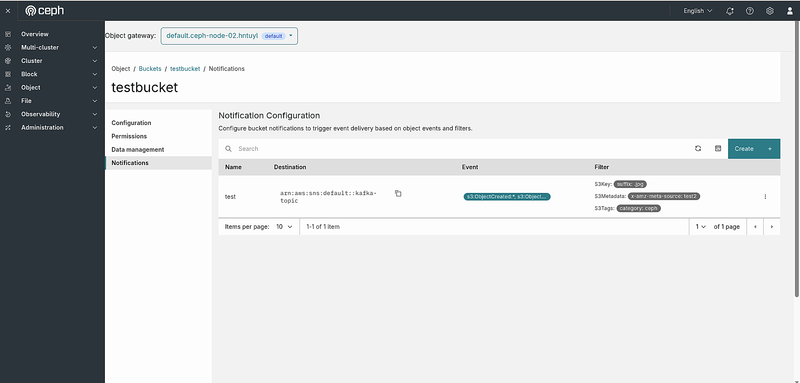
_Figure: Notification Configuration table for `testbucket` showing the created
notification `test` targeting `arn:aws:sns:default::test` with event
`s3:ObjectCreated:*` and S3 key suffix filter `.jpg`._

### Editing a Notification Configuration

To update an existing notification, click the **⋮** action menu at the end of
the notification row and select **Edit**. The **Edit Notification
configuration** dialog opens pre-populated with the current settings — the same
form used during creation, with all fields editable except **Name** (which is
fixed after creation).

The pre-filled values reflect what was configured at creation time:

- **Name** — read-only; the unique notification name (e.g., `test`).
- **Topic** — the currently linked topic ARN (e.g.,
  `arn:aws:sns:default::test`); can be changed to redirect events to a different
  destination.
- **Event** — the event type filter; can be updated or cleared to match all
  events.
- **Advanced filters** — all S3 Key, Metadata, and Tags filter rules are shown
  and fully editable. For example, an existing S3 Key filter of `suffix: .jpg`
  will be displayed and can be modified or removed.

Click **Edit** to save the changes. The Notifications table will immediately
reflect the updated destination, event, and filter values.

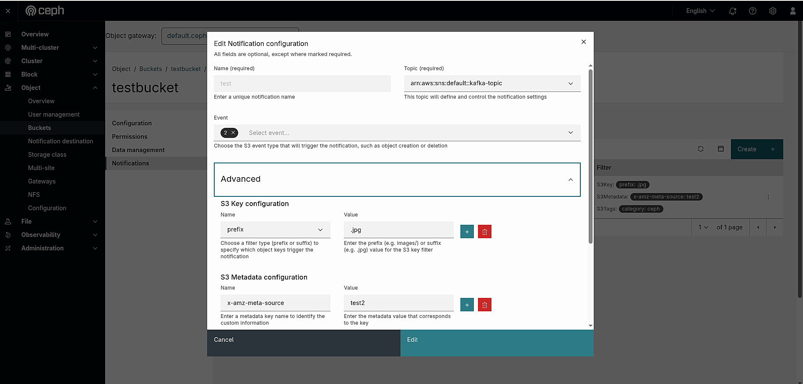
_Figure: Edit Notification configuration dialog for `test` — Name (read-only),
Topic, and Event fields pre-populated._

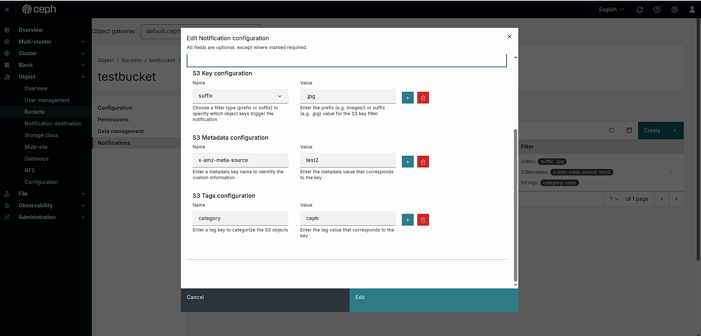
_Figure: Edit Notification configuration dialog for `test` — Advanced filters
section showing the pre-populated S3 Key filter (`suffix: .jpg`)._

### Deleting a Notification Configuration

To remove a notification from a bucket, click the **⋮** action menu on the
notification row and select **Delete**. A confirmation dialog will appear:

> **Delete Notification**
> Are you sure that you want to delete **test**?

The **Delete Notification** button remains disabled until you check the **"Yes,
I am sure."** checkbox. This two-step confirmation prevents accidental deletion.
Once checked, the button becomes active — click it to permanently remove the
notification configuration from the bucket.

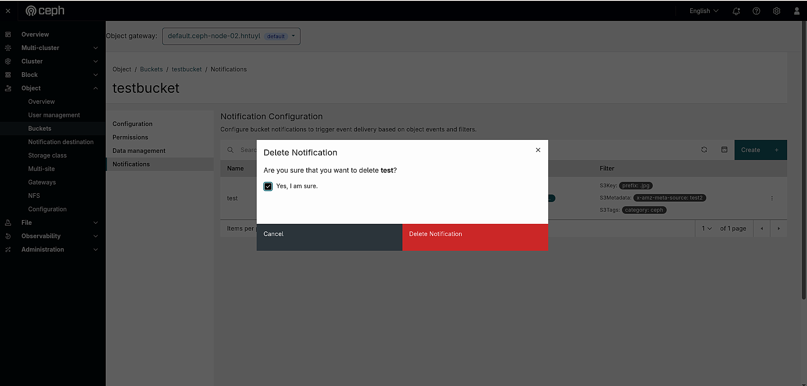
_Figure: Delete Notification confirmation dialog for `test`, showing the
required acknowledgement checkbox before deletion can proceed._

## 5. Validating End-to-End with a Kafka Server

To test that notifications are delivered, you need a running Kafka broker. Start
the broker and the Kafka UI with Docker Compose:

```
docker compose up -d kafka
```

Then create a topic for RGW to publish to, from a shell inside the Kafka
container:

```
docker exec -it kafka bash
kafka-topics --create --bootstrap-server localhost:9082 --topic ui-topic
```

The new topic appears in the Kafka UI, with no messages yet:

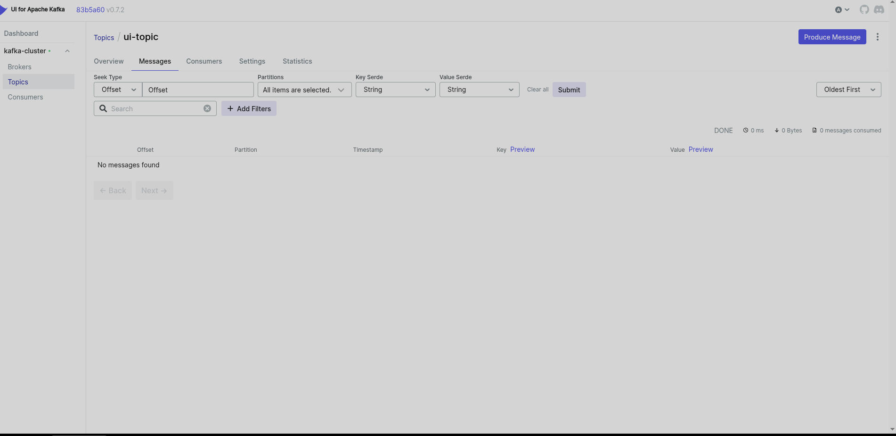
_Figure: Topic `ui-topic` in the Kafka UI, before any notifications arrive._

Once the topic exists and a bucket notification is configured to target it,
upload an object to the bucket. The event message will appear on the topic:

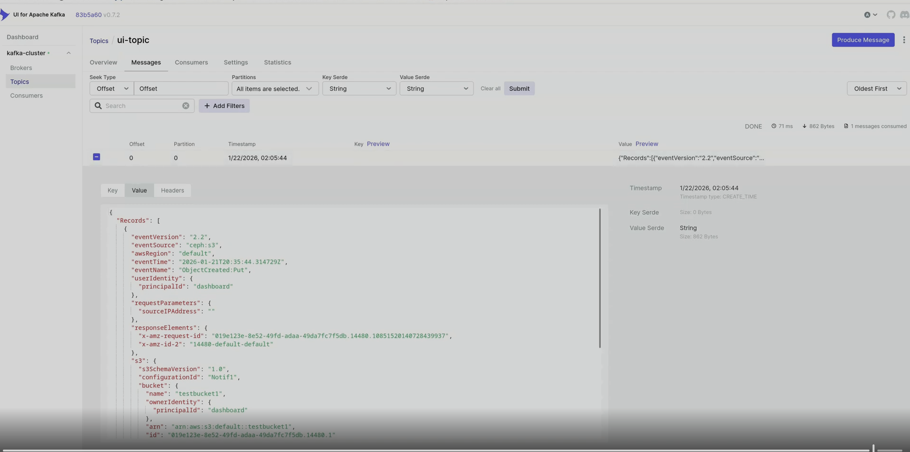
_Figure: Notification message received on `ui-topic` after an object upload._

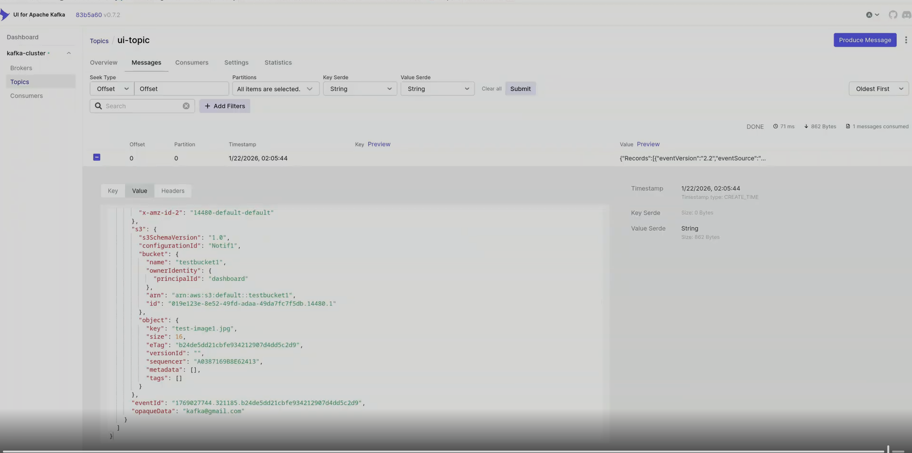
_Figure: Detailed view of the notification message payload delivered to
`ui-topic`._

For the full Docker Compose setup and step-by-step instructions, see the [Setup
RGW Bucket Notification using
Kafka](https://github.com/rhcs-dashboard/ceph-dev/wiki/Setup-RGW-Bucket-Notification-using-Kafka)
guide.

## Conclusion

Ceph RGW bucket notifications bring event-driven architecture to your object
storage — and the Ceph Dashboard makes the entire lifecycle manageable without
writing a single API call.

In this walkthrough, we covered the complete end-to-end flow:

1. **Creating a notification destination** — choosing from AMQP, Kafka, or
   HTTP/HTTPS endpoint types, each with its own protocol-specific attributes
   (exchange, brokers, vhost, SSL, ACK level) and a set of shared delivery
   controls (Persistent, TTL, Max retries, Opaque data, Policy).
2. **Exploring the destination detail view** — inspecting the topic's access
   policy in the **Policies** tab and the buckets that use it in the
   **Subscribed buckets** tab.
3. **Managing destinations** — editing endpoint parameters and safely deleting
   topics using the two-step confirmation guard.
4. **Configuring bucket notifications** — attaching a notification to a specific
   bucket by selecting a topic, an S3 event type, and optional Advanced filters
   (S3 Key prefix/suffix, Metadata, and Tags) to precisely control which object
   events get published.
5. **Managing bucket notifications** — editing existing notification
   configurations to update topics, events, or filters, and deleting them with
   the same confirmation guard.

Whether you are building real-time image processing pipelines, streaming audit
logs to a SIEM, triggering cache invalidations, or ingesting data into a Kafka
consumer, the Ceph Dashboard gives you a clear, guided interface to configure
and maintain bucket notifications at scale. Take the opportunity to explore this
feature in your Ceph cluster and unlock event-driven workflows for your object
storage.

## Further Reading

- [Ceph RGW Bucket Notifications — Official
  Documentation](https://docs.ceph.com/en/latest/radosgw/notifications/) — the
  official Ceph reference for RGW bucket notifications, covering the
  SNS-compatible API, supported event types, filter rules, and endpoint
  configuration for AMQP, Kafka, and HTTP.
